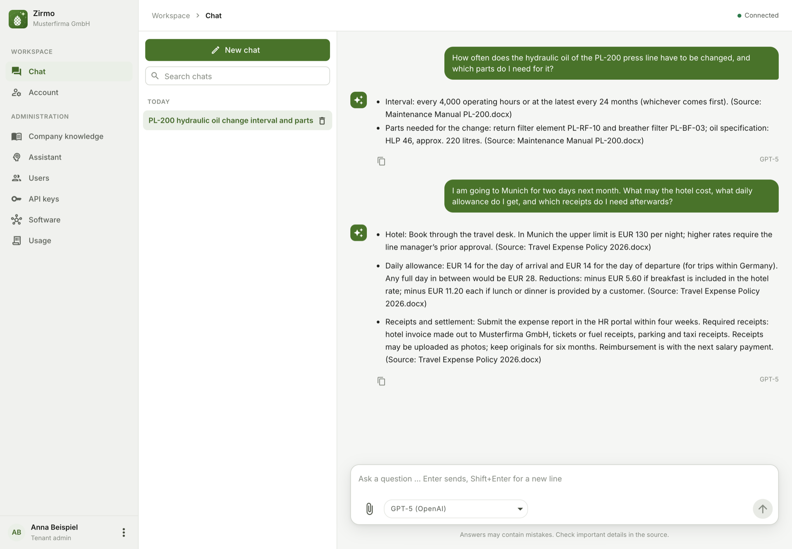
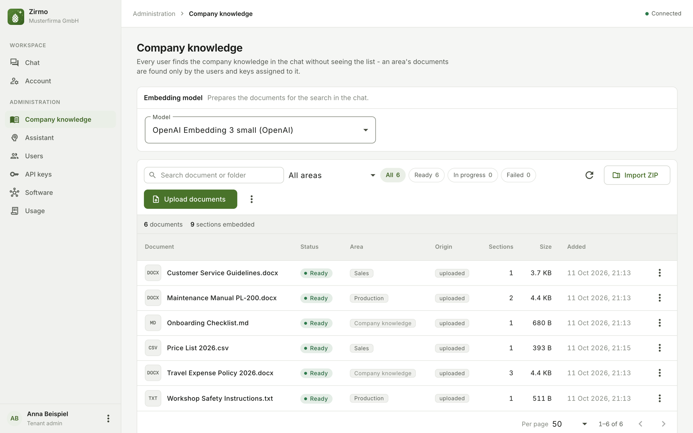
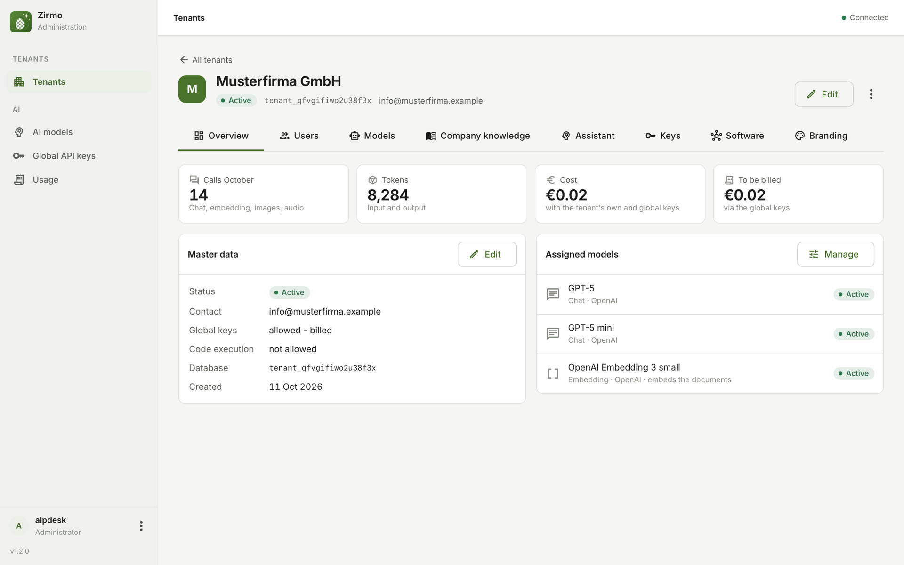

# Zirmo - installing and running

*A product of Alpdesk.*

**An AI assistant that knows a company's own documents - for companies of every trade: services, crafts, industry.
Several companies on one installation, each with a database of its own, with the AI provider of your choice or models
on your own servers.**

[](../../../LICENSE)
[](https://zirmo.dev/)

This folder holds everything needed to run Zirmo on a server of your own: the compose files, the Caddyfile, the
template of the settings and this guide; the source code is the rest of the repository. The images come from the
GitHub Container Registry:

| Image | What it is |
|---|---|
| `ghcr.io/xprojects-de/alpdesk-ai:<version>` | The application: a Micronaut (Java 25) backend with the web frontend baked in |
| `ghcr.io/xprojects-de/alpdesk-ai-sandbox:<version>` | Optional: the sandbox in which the chat runs Python and shell commands, one per tenant |
| `ghcr.io/xprojects-de/alpdesk-ai-sandbox-video:<version>` | Optional, instead of the sandbox for a tenant that examines videos: the same with ffmpeg and pose estimation (about 1 GB) - see "Code execution" |
| `ghcr.io/xprojects-de/alpdesk-ai-embeddings:<version>` | Optional: Ollama with the embedding model `bge-m3` baked in, for the company's knowledge without a cloud provider (about 5 GB) |

Every release is a tag `v<version>` of the repository, its compose files pinned to the images of that version. Install
and update from a tag, not from `main` - between two releases `main` may name images that do not exist yet. A tag with a label - `v2.0.0-rc.1` - is a pre-release, for trying a version before it is released:
check it out like a release (`git checkout v2.0.0-rc.1`), not on an installation you depend on - its database may not
take the release that follows without being set up again.

## What it does

- **Tenants with their own people.** Every company (tenant) gets its own database for its documents, embeddings and
  chat history. Its employees log in and chat; its tenant admins keep users and their groups (which knowledge areas
  and which connected software a group's members may use), keys, the company's knowledge, the assistant's
  instructions and an eye on the usage. The operator (admin) manages the tenants, the model catalog and
  prices.
- **The company's knowledge in the chat.** Documents - one by one, as a ZIP archive with folders, or pushed by the
  company's software - are read (PDF, DOCX, ODT, RTF, TXT, Markdown, HTML, PPTX, XLSX, ODS, CSV; images and scanned
  pages through an image model), embedded and found by every user in the chat without seeing the list.
- **A chat that works with files.** Files in the conversation (text, images, scans, audio, video), files created as
  answers (DOCX, XLSX, PDF, CSV, ...), chat templates, and an agent loop with tools - also a web search for current
  facts through Tavily (optional, per user group and key, always after the company's documents).
- **A handbook beside the chat.** A static website for the whole company and one per knowledge area, uploaded as a
  ZIP and shown sandboxed to the people it is meant for.
- **Any provider, or your own models.** Anthropic, OpenAI, Gemini - with the tenant's own keys or the operator's
  (then billed) - or models on own hardware through Ollama or any OpenAI-compatible server (vLLM, LM Studio, Mistral);
  Claude and GPT in an EU region through Amazon Bedrock or Azure OpenAI with a cloud account of your own.
- **Connected to the company's software.** The client software uses the API at `/api/v1` with the tenant's API key
  (documented at `/swagger` of an installation). The chat can call the tools of the company's software over MCP -
  reading ones directly, changing ones only after the user's decision. Through the tenant's own MCP server Claude
  Code, claude.ai, Claude Desktop, Cowork or Copilot ask the assistant or search and read the company's documents
  themselves - with MCP keys the tenant admin creates, each with its own knowledge areas, connected software and web
  search; claude.ai and Cowork take the server as a custom connector with the key as a request header. A connected
  software switched "Directly to MCP clients" ("Direkt an MCP-Clients") reaches them directly: its reading tools and
  prompts appear among the server's tools (`<software>__<tool>`), while its address and key stay in the installation -
  and its changing tools too, for a key the tenant admin lets change in it ("Darf ändern in"); whether its user
  is asked before such a call is the client's matter (SECURITY.md). What the software sends reaches the client
  unchanged - long text, images, files with their own type, links to a web address as links - and, switched
  "Ressourcen an MCP-Clients", its resources too, their addresses starting with the software's name and a dot.
- **Single sign-on** through a WAM proxy that passes the signed-in person on in a header (optional).
- **Branding** per installation and per tenant: name, colour and logo - with a login page of its own for every tenant.

## Screenshots

**The chat** - every user asks, the assistant answers from the company's documents and names its source:



**The company's knowledge** - what the tenant admin uploaded, its state and the knowledge area it belongs to:



**A tenant at the operator** - usage this month, master data and the models it may use:



<sub>Invented example data, answers by GPT-5.</sub>

## Security and privacy

Zirmo handles company documents and employees' chats and sends them to the AI providers you configure. Before
running an installation for others, read:

- [SECURITY.md](../../../SECURITY.md) - what the software assumes (HTTPS only, the database never reachable from outside, your
  own secrets), what it deliberately does not do, and how to report a vulnerability;
- [docs/privacy.md](../../../docs/privacy.md) - what is stored where, what leaves the server, who is responsible under the GDPR,
  and deleting.

## Installation

Needs a Linux server with Podman and `podman-compose` (Docker with `docker compose` works the same), a domain pointing
at it and the ports 80 and 443 free: Caddy fetches the certificate itself and serves HTTPS only. Where the two ports are
taken - a NAS, a server whose own proxy serves other applications - the stack runs without Caddy behind that
proxy ("Behind an own reverse proxy"). The images come for
`linux/amd64` and `linux/arm64` under the same tags - an x86 server, an ARM server or a Raspberry Pi 5 with a 64-bit
OS pull the right one; Podman or Docker on an Apple Silicon Mac runs the arm64 images natively.

**Sizing** (measured on a test installation): the app takes about 1 GB of memory, PostgreSQL and Caddy together less
than 150 MB - plan **at least 4 GB of RAM and 2 CPUs**. With the local embeddings image ("Embeddings with a local
Ollama") plan **8 GB**: it takes about 2 GB while it embeds - a Raspberry Pi 5 with 8 GB meets both, a NAS with 2 GB
does not. On a Raspberry Pi the embedding model runs on the CPU alone and embeds noticeably slower than on a server;
the chat itself is answered by the provider. A tenant's sandbox ("Code execution") takes about 20 MB
when idle and up to 2 GB while an answer runs code. The images take about 2 GB of disk, the embeddings image about
5 GB more; the documents, the databases and the chat's files come on top. With many tenants or large knowledge bases see "Sizing
PostgreSQL".

In the folder for the installation (e.g. `/opt`), with the latest release's tag:

```shell
git clone --branch v<version> https://github.com/xprojects-de/alpdesk-ai.git
cd alpdesk-ai/Backend/podman/public                       # the installation lives in this folder
cp .env.example .env && chmod 600 .env                    # then replace every CHANGE_ME in .env
podman-compose -f docker-compose.prod.yml up -d
```

Open `https://<APP_DOMAIN>` and log in with `APP_USERNAME` / `APP_PASSWORD`. Then add a model to the catalog
("AI models", "KI-Modelle") with a provider key, create a tenant and its first user, and chat.

Without git: unpack the tag's source download (releases page, "Source code") and use its folder
`Backend/podman/public`. An update is the next tag's download unpacked over it, keeping `.env`, `sandboxes/` and
`pgdata/`.

A required value missing in `.env` stops `podman-compose` with its name. The app refuses to start while
`APP_USERNAME`, `APP_PASSWORD`, `APP_SECRET_KEY` or `JWT_GENERATOR_SIGNATURE_SECRET` is missing, empty or still
`CHANGE_ME`, and while `DB_PASSWORD` is still `CHANGE_ME`. `DB_PASSWORD` only counts when `./pgdata` is created: an
installation whose database was initialised with another password needs the role's password changed first
(`podman exec -it alpdesk-ai-db psql -U alpdeskai -d alpdesk_ai -c "ALTER ROLE alpdeskai PASSWORD '<new>'"`), then the
value in `.env`. The Caddyfile serves HTTPS only (Caddy redirects plain HTTP) - never add a plain-HTTP site in front of
the app, since passwords and API keys would travel unencrypted. PostgreSQL never gets a published port.

Nothing of the installation is in the files of the repository: secrets and domain live in `.env`, the tenants'
sandboxes in `sandboxes/`, the database in `./pgdata` - all three next to the compose files and ignored by git
(`.gitignore`), so an update never touches them. Don't edit the tracked files: what an installation needs differently goes into `.env`.

## Update

Take a backup first (see "Backups"), then in the installation folder (`.../Backend/podman/public`):

```shell
git fetch --tags && git checkout v<version>
podman-compose -f docker-compose.prod.yml pull
podman-compose -f docker-compose.prod.yml up -d
for f in sandboxes/*.env; do [ -e "$f" ] || continue; n="$(basename "$f" .env)"; podman-compose --env-file "$f" -p "alpdesk-ai-sandbox-$n" -f docker-compose.tenant-sandbox.yml up -d; done
podman image prune -f                                      # removes the previous version's images
```

The embeddings image ("Embeddings with a local Ollama") is tagged with every release's version too; after an update
start it again with `podman-compose -f docker-compose.embeddings.yml up -d` (the model rarely changes - an unchanged
one is not downloaded again). The reranker ("Reranking with a local
reranker") names a fixed TEI version - a newer one is a new tag in `RERANKER_IMAGE`.

A new optional setting of a release shows up in its `.env.example`; compare it with your `.env`
(`diff .env.example .env`). A new **required** one stops `podman-compose` with its name. The loop starts every
tenant's sandbox ("Code execution") with the release's image; without tenant sandboxes it does nothing. A tenant's own
sandbox image is rebuilt on the release's sandbox and tagged with its version before the loop ("Your own sandbox
image"). Going back to
an earlier version is the same with that version's tag - but database migrations cannot be undone, so only with the
backup taken before the update.

### From 1.x to 2.0.0: the installation moves into `Backend/podman/public`

Up to 1.x this repository held the installation's files alone, at its root; since 2.0.0 it holds the source code too,
and the installation's files live in `Backend/podman/public`. An installation cloned from it moves once - containers,
volumes and the database stay as they are (the project name `alpdesk-ai` is unchanged). Take a backup first (see
"Backups"), then in the old installation folder:

```shell
podman-compose -f docker-compose.prod.yml down             # with the file of 1.x, before it is replaced (proxy: docker-compose.proxy.yml)
git fetch --tags && git checkout v2.0.0                    # the files of 1.x leave the root; .env, sandboxes/ and pgdata/ stay
mv .env pgdata Backend/podman/public/
[ -d sandboxes ] && mv sandboxes Backend/podman/public/
cd Backend/podman/public
```

then go on as under "Update" from `podman-compose ... pull`. A script or a cron job of yours that names the old folder
(a backup, the sandboxes' loop) names `.../Backend/podman/public` from now on.

## Configuration

The app's environment variables, set through the file `.env` next to `docker-compose.prod.yml` (template
[.env.example](.env.example)); the compose file passes them on and takes the database password from `DB_PASSWORD`.

| Variable | Purpose |
|---|---|
| `APP_DOMAIN` | The domain Caddy serves and fetches the certificate for, without `https://` |
| `APP_USERNAME` / `APP_PASSWORD` | The admin login - the password at least 12 characters |
| `APP_SECRET_KEY` | AES key encrypting the stored AI provider keys - `openssl rand -base64 32`. **Back it up**: losing or changing it makes every stored key unreadable (they must be entered again) |
| `JWT_GENERATOR_SIGNATURE_SECRET` | JWT signing secret (at least 32 characters) - `openssl rand -base64 48`; changing it logs everyone out - change it together with a leaked `APP_PASSWORD`, whose admin sessions a new password alone does not end |
| `DB_PASSWORD` | The database password - `openssl rand -base64 48` |
| `APP_BRANDING_NAME` / `APP_BRANDING_PRIMARY_COLOR` / `APP_BRANDING_LOGO` | Optional, the installation's look (default "Zirmo", `#49732a`, the Zirmo logo; `APP_BRANDING_LOGO=` empty = no logo) - the admin's dashboard and every tenant the admin gave no look of its own. The logo is a PNG, JPEG or WebP of at most 512 KB: copy it into the volume `files` (`podman cp logo.png alpdesk-ai:/home/app/files/branding-logo.png`) and set `/home/app/files/branding-logo.png` |
| `APP_AI_PLAIN_HTTP_HOSTS` | Optional: the hosts of own model servers reached over plain HTTP, comma separated (e.g. `ollama,10.0.0.5`) - every other server needs HTTPS. See "Own model servers". A listed host is also exempt from the "no internal address" rule, and the exemption counts for the addresses of connected software (MCP) that every tenant admin may enter: any port of it becomes reachable to the app's requests - never list `localhost` or the app's own container |
| `USE_SYSTEM_CA_CERTS` | Optional: `1` trusts the certificates of the company's own authorities in the volume's `certificates/` - see "Own model servers" (FTPS file stores and S3 endpoints too) |
| `APP_FILE_STORE_INTERNAL_HOSTS` | Optional: the hosts of file stores (SFTP, FTPS, S3 endpoints) in the internal network, comma separated (e.g. `logs.intern,10.0.5.20`) - every other file store must be a public host. Every tenant admin may enter a listed host, on any port: never list `localhost`, the database or the app's own container. A listed host may be an S3 endpoint over plain `http://` (see "File stores") |
| `JAVA_TOOL_OPTIONS` | Optional JVM options. Recommended: a fixed heap and a clean restart when it runs out, e.g. `-Xmx2g -XX:+ExitOnOutOfMemoryError` on a server with 8 GB (`-Xmx1g` on 4 GB) - without it the JVM takes a quarter of the server's memory and keeps running after it ran out of it |
| `MICRONAUT_SERVER_CONTEXT_PATH` | Optional: the sub-path behind a reverse proxy - see "Behind a reverse proxy under a sub-path" |
| `APP_WAM_ENABLED` / `APP_WAM_USER_HEADER` / `APP_WAM_NAME_HEADER` | Optional: sign-in through a WAM proxy - see "Sign-in through a WAM proxy" |
| `APP_WAM_GROUPS_HEADER` / `APP_WAM_GROUPS_SEPARATOR` | Optional: the person's IDM groups from the WAM proxy, checked against the user groups' WAM groups - see "Sign-in through a WAM proxy" |
| `APP_MONITORING_MAIL_TO` / `APP_MAIL_*` / `APP_MONITORING_DAILY_REPORT_CRON` | Optional: the daily report by e-mail - see "Daily report" |
| `APP_A2A_TASK_RETENTION_HOURS` | Optional: how long the company's assistant at `/a2a` keeps a question answered as a task (streamed, or asked with `returnImmediately`) for the key that asked - default `24`, empty keeps them |
| `APP_A2A_TIMEOUT` / `APP_A2A_MAX_ANSWER_CHARS` | Optional: for a company whose chat answers through its A2A agent - how long the agent's answer may take (default `10m`) and the longest answer kept (default `200000` characters, a longer one is cut) |
| `APP_CHAT_VIDEO_MAX_SIZE` / `APP_CHAT_VIDEO_ROUNDS` | Optional: the size a video in the chat may have (default `500MB`, at most `512MB`), and the rounds the assistant may take for an answer about one (default `16` - each round costs tokens) - see "Code execution" |
| `APP_SEARCH_RERANK_CANDIDATES` | Optional: how many of a search's candidates a tenant's reranker reorders, 2 to 40 (default `10`, for a reranker on a CPU) - `20` with a GPU, see "Reranking with a local reranker" |
| `APP_DOC_SITE_MAX_ZIP_SIZE` | Optional: the largest ZIP a handbook's website may be uploaded as (default `100MB`, at most `512MB`); unpacked it may hold five times as much |
| `APP_TASK_RUN_RETENTION_DAYS` | Optional: how many days a scheduled task's run stays after it ended (default `14`) - with the lines its steps read, its findings and its steps; checked every hour. Set empty to keep runs until a tenant admin deletes them or their task. The read positions stay: the next run goes on where the last one stopped |
| `APP_CHAT_VIDEO_RETENTION_HOURS` / `APP_CHAT_FILE_RETENTION_DAYS` / `APP_CHAT_CLEANUP_CRON` | Optional: how long the chat's files stay before they are deleted - an uploaded video the hours after its upload (default `8`), every other file, uploaded or created, the days after it was stored (default `14`); set one empty to keep those files until they or their conversation are deleted. The conversation keeps a deleted file listed as expired. The cleanup runs every hour (a cron expression, seconds first) |

Data lives in PostgreSQL with pgvector (`./pgdata`; the schema is migrated on startup): the management database,
every tenant's own database - and in them the embeddings, the chat history and everything else the admins manage. The
volume `alpdesk-ai_files` (mounted at `/home/app/files`) holds what is a file: the chat's files (uploaded and created;
deleted after 14 days, a video after 8 hours - `APP_CHAT_FILE_RETENTION_DAYS`, `APP_CHAT_VIDEO_RETENTION_HOURS`), an
uploaded document only until it is embedded, **the handbook's websites for good**, the logos and the `certificates/`
folder. **Back up both** - the databases only hold the files' keys, and the handbook's websites exist nowhere else.
The volume may lie elsewhere: a bind mount of another disk or an NFS share instead of the named volume, owned by
UID 999 (the app runs as that user, not as root - the named volume is just the way that needs no `chown`); moving it
is `tar` over and the mount changed, with the app stopped. The databases may move to a server of their own too
("Sizing PostgreSQL").

`/watchdog` is an anonymous, side-effect-free liveness endpoint (HTTP 200) for monitoring.

## Sizing PostgreSQL

PostgreSQL's defaults carry a small installation: a handful of tenants, some thousand documents each. Two values
decide how far it goes beyond that - both are set in the compose file, where they stand commented out at the
`postgres` service (`command: postgres -c ...`); change them, then `podman-compose up -d` restarts the database.

- **Connections** (`max_connections`, default 100): the app keeps a pool of 10 connections for the management database
  and opens up to 3 per tenant database in use (closed again after half a minute idle). 30 busy tenants may reach
  10 + 30 × 3 = 100 - the default - and the backup and your own tools come on top. From about 20 tenants set
  `max_connections=200`; each connection costs a few MB of memory only.
- **Memory for the indexes** (`shared_buffers`, default 128 MB): every tenant database holds a vector index (HNSW) and
  a full-text index over its documents' chunks. A search is fast while the index it reads sits in memory and ten to
  fifty times slower from disk. Rule of thumb: a chunk takes about 5 KB of data and 3-4 KB of index - 100,000
  documents of 20 chunks each are 2 million chunks, about 10 GB of data and 7 GB of index. Set `shared_buffers` to
  about a quarter of the server's memory (`4GB` on a 16 GB server) and give the server enough memory for the indexes
  of the tenants that are searched most. With many large tenants run PostgreSQL on a server of its own (`DATASOURCES_*`
  point the app at it; the compose file then runs without the `postgres` service).
- **Index builds** (`maintenance_work_mem`, default 64 MB): "Embed again" and a new embedding model fill a tenant's
  index anew - with 2 million chunks that takes hours, during which the tenant's search finds only what is embedded
  so far. `maintenance_work_mem=1GB` makes the build several times faster.

What else to know with large tenants: the vector search reads at most 20,000 nearest chunks before it checks the
knowledge area and the document's state (`hnsw.max_scan_tuples`) - in a tenant with millions of chunks a search
limited to a tiny knowledge area may find fewer than asked; `pg_dumpall` of 30 databases takes long and much disk -
from that size take base backups with WAL archiving instead (`pg_basebackup`), and keep the databases' free disk
space in the daily report in view. The load test of the source code (`CapacitySpec`) is the way to measure an
installation's own numbers before promising them.

### PostgreSQL on a server of its own

The same pod, the database elsewhere - the app reaches it through three variables only. In `.env` set
`DATASOURCES_DEFAULT_URL` (with TLS: `jdbc:postgresql://db.example.com:5432/alpdesk_ai?sslmode=require` - without
it passwords and documents would cross the network in the clear) and `DATASOURCES_DEFAULT_USERNAME`, keep
`DB_PASSWORD` as that role's password, and remove the service `postgres` and the `depends_on` on it from the compose
file. On the database server: pgvector installed, the app's role with **CREATEDB** (it creates and drops every
tenant's database), `pg_hba.conf` admitting the app's server only, the backups run there. Not foreseen: several
database servers (the app has one), or a pooler such as PgBouncer in between (the app's pools are small, and the
vector search sets `SET LOCAL` options a transaction pooler does not keep).

**Moving later** is a matter of operation, not of the app: stop the app (`podman-compose -f docker-compose.prod.yml
stop alpdesk-ai`), `pg_dumpall` from the pod's database as under "Backups" (it carries the management database, every
tenant's database and the role), restore on the new server (`psql -f`), set the three variables, start the app - the
migrations are already applied, the tenants' pools open on first use. The downtime is the dump and the restore;
logical replication to the new server and a switch avoids it (plain PostgreSQL, nothing of ours). The volume
`alpdesk-ai_files` and `.env` stay with the pod: the chat's files live in the volume, and the stored keys move with
the database and stay readable with the same `APP_SECRET_KEY`.

## Backups

```shell
podman exec alpdesk-ai-db pg_dumpall -U alpdeskai > backup_all_$(date +%F).sql
podman run --rm -v alpdesk-ai_files:/files -v $PWD:/backup docker.io/library/alpine tar czf /backup/files_$(date +%F).tgz -C /files .
```

The first line dumps every database at once: the management database `alpdesk_ai` and every tenant's own database
(`tenant_...`, the name is shown in the admin's tenant dialog). A single one is dumped and restored this way:

```shell
podman exec alpdesk-ai-db pg_dump -U alpdeskai -Fc alpdesk_ai > backup_$(date +%F).dump
# restore into an empty database:
podman exec -i alpdesk-ai-db pg_restore -U alpdeskai -d alpdesk_ai --clean --if-exists < backup.dump
```

Keep `.env` safe as well - without `APP_SECRET_KEY` the stored provider keys cannot be read. Take a backup before every
update: database migrations cannot be undone.

## Logs

```shell
podman-compose -f docker-compose.prod.yml logs -f
```

The log lines carry date and time (`2026-10-01 14:03:12.345 [thread] LEVEL logger - message`), without colour codes.
They never contain a document's content, a prompt or a provider's answer.

## Daily report

Every morning at 06:00 (Europe/Berlin) the app mails a report to the addresses in `APP_MONITORING_MAIL_TO` - also when
everything is fine: **a report that does not arrive means the app or sending mail is down.** It covers the last 24 hours:

- what needs attention: little free space on the disk of the stored files, documents waiting over an hour to be
  embedded or failed, a tenant database that cannot be read, people waiting for access (WAM);
- the system: version, start (a restart is pointed out), PostgreSQL, the size of the databases, the free disk space;
- every active tenant: its database size, users, documents (ready, waiting, failed, new), questions, the users who
  asked, model calls and their cost - in the last 24 hours and the month so far, with the part of the global keys;
- the application log: warnings and errors counted, the loudest sources and the newest entries (kept in memory - a
  restart empties it; the container log keeps everything).

It holds counts, sizes and amounts and the tenants' names - no document or file names, no questions or answers. Its log
lines are those of the container log at warning level and above, which never contain a document's content, a prompt or
a provider's answer. When the database cannot be read, the report still goes out with what the app knows without it.

```dotenv
APP_MONITORING_MAIL_TO=ops@example.com
APP_MAIL_HOST=smtp.example.com
APP_MAIL_PORT=587
APP_MAIL_SECURITY=STARTTLS
APP_MAIL_USERNAME=report@example.com
APP_MAIL_PASSWORD=...
```

`APP_MAIL_SECURITY` is `STARTTLS` (port 587), `SSL` (port 465) or `NONE`; `APP_MAIL_FROM` defaults to the username.
Without a mail server or recipients nothing is sent. A recipient that is no e-mail address, or a mail server without a
sender address (neither `APP_MAIL_FROM` nor an address as `APP_MAIL_USERNAME`), stops the start on purpose - so a typo
shows at once, not at 06:00; the log names the setting. To try the settings, the admin presses **Send daily report now**
on the page "Application log" - a refused mail is shown there with the mail server's reason. The same page shows the
recent warnings and errors at any time, searchable, with their stack traces - for the admin only.

## File stores

Tenant admins add the servers their scheduled tasks and knowledge sources read files from: SFTP and FTPS servers
(confirmed by the fingerprint of their key or certificate before the password is sent), buckets of Amazon S3 or an
S3-compatible store (an own endpoint such as `https://s3.example.com`; plain `http://` only to a host in
`APP_FILE_STORE_INTERNAL_HOSTS`) and document libraries of SharePoint or a OneDrive. An S3 store reads with an access
key of its own - give it read rights on the bucket only, for example:

```json
{
  "Version": "2012-10-17",
  "Statement": [
    {"Effect": "Allow", "Action": "s3:ListBucket", "Resource": "arn:aws:s3:::example-logs"},
    {"Effect": "Allow", "Action": "s3:GetObject", "Resource": "arn:aws:s3:::example-logs/*"}
  ]
}
```

A scheduled task may also write into a store (a CSV of rows taken out of documents) - only one whose switch "Aufgaben
dürfen hier schreiben" a tenant admin turned on. Its key then needs `s3:PutObject` on the folder too, e.g.
`{"Effect": "Allow", "Action": "s3:PutObject", "Resource": "arn:aws:s3:::example-logs/export/*"}`; an SFTP or FTPS
account needs write rights on the folder (a task writes a temporary file beside the CSV and renames it over it). Keep
the folder a task writes to out of the knowledge sources - its CSV would be found by everyone in the chat.

A mailbox (IMAP) is a store too, read only: documents mailed to an address of the company's own become files for
scheduled tasks and knowledge sources - every message of the last days (365 by default) is a folder, its attachments
and a `mail.txt` with its text the files. Nothing in the mailbox is changed, not even marked as read - archive it
yourself. Use IMAPS (993) or STARTTLS; an account with an app password where the provider has them. Unencrypted IMAP
only to a host in `APP_FILE_STORE_INTERNAL_HOSTS`.

A SharePoint store reads through Microsoft Graph with an app registration of the company's Entra ID:

1. Register an app, create a client secret (it expires - two years at most; the store's check then says so).
2. Add the application permission `Sites.Selected` (Microsoft Graph) and grant admin consent - nothing else.
3. Grant the app read on the one site or OneDrive it is to read, through Graph
   (`POST /sites/{site-id}/permissions` with `{"roles": ["read"], "grantedToIdentities": [{"application": {"id":
   "<client id>"}}]}`) or PnP PowerShell (`Grant-PnPAzureADAppSitePermission`). A store tasks write to needs the role
   `write` instead of `read`.
4. Enter the directory (tenant) ID, the client ID, the secret and the site's address - a OneDrive's is
   `https://<company>-my.sharepoint.com/personal/<name>`.

## Own model servers

The admin enters an own model server with its model in the catalog (page "AI models" - "KI-Modelle"): provider
"Ollama" (its own API, e.g. `https://ollama.example.com`) or "OpenAI-compatible" ("OpenAI-kompatibel"; any server
with the OpenAI API, e.g. a company's model farm or `https://api.mistral.ai/v1`), the server's address and, if it asks
for one, its key.

- **Claude in an EU region through Amazon Bedrock** with an AWS account of your own - no server to run:
  1. In the Bedrock console of the region (e.g. Frankfurt, `eu-central-1`) enable the Claude models.
  2. Create an IAM user for Zirmo with nothing but this policy, and an access key for it:
     ```json
     {
       "Version": "2012-10-17",
       "Statement": [{
         "Effect": "Allow",
         "Action": ["bedrock:InvokeModel", "bedrock:InvokeModelWithResponseStream"],
         "Resource": ["arn:aws:bedrock:*::foundation-model/anthropic.*",
                      "arn:aws:bedrock:*:<account-id>:inference-profile/eu.anthropic.*"]
       }]
     }
     ```
  3. In the catalog: provider "Amazon Bedrock", address `https://bedrock-runtime.eu-central-1.amazonaws.com`, key
     `ACCESS_KEY_ID:SECRET_ACCESS_KEY`, model id the EU inference profile Bedrock shows (`eu.anthropic.…`) - it keeps
     the processing in the EU. Chat models only; the company's knowledge keeps its embedding model.

  A new AWS account must first submit Anthropic's use case form (a notice in the model catalog); some models are
  approved for it only later - the playground tells which answer. The log names Bedrock's error code when a call
  fails: `AccessDeniedException` - the model is not enabled or the
  policy does not allow it; `UnrecognizedClientException` - the key is wrong.
- **GPT in an EU region through Azure OpenAI**: provider "OpenAI-compatible", address
  `https://<resource>.openai.azure.com/openai/v1`, the resource's key, the deployment's name as model id. Create the
  deployment as type "Data Zone EU" - "Global" may process anywhere. Not tested by us yet - tell us if it works.

- **HTTPS only.** The server's key and the company's documents go there. Plain HTTP only to the hosts in
  `APP_AI_PLAIN_HTTP_HOSTS` - a server in the same pod or the internal network.
- **Ollama itself has neither TLS nor keys.** Put a reverse proxy in front of it that does both, e.g. a Caddy on the
  Ollama machine (the key goes into the catalog entry; the app sends it as `Authorization: Bearer <key>`):
  ```
  https://ollama.example.com {
      @authorized header Authorization "Bearer {$OLLAMA_PROXY_KEY}"
      handle @authorized {
          reverse_proxy 127.0.0.1:11434
      }
      respond 401
  }
  ```
  The context length is sent with every request (catalog field "Context length" - "Kontextlänge", default 32768) - the
  Ollama server needs no `OLLAMA_CONTEXT_LENGTH`, only enough memory for it.
- **Keep the model loaded between the rounds of an answer**: the chat and scheduled tasks send the whole conversation
  again in every round, and both servers reuse what a prompt shares with the one before - much faster, at no cost.
  Ollama does so while the model stays loaded (`OLLAMA_KEEP_ALIVE`, e.g. `30m`) and the conversation fits its context
  length; vLLM with its prefix caching (`--enable-prefix-caching`, on by default in recent versions).
- **The company's knowledge needs an embedding model** - a local one: "Embeddings with a local Ollama".
- **Choose the tenant's search language** when creating it (the tenant dialog; later under "Company knowledge"): the
  language its documents are written in, so the search finds other forms of a word too. Without a choice the tenant is
  searched without a language - words are found only as written. Tenants from before version 1.3 keep German.
- **A certificate of the company's own authority** (no public one): the app must trust it - there is no setting that
  skips the certificate check. Ask the company's IT for the certificate of its root authority (PEM, the text starting
  with `-----BEGIN CERTIFICATE-----`; one file may hold several), name it `*.crt` and copy it into the volume `files`:
  ```shell
  podman exec alpdesk-ai mkdir -p /home/app/files/certificates
  podman cp company-ca.crt alpdesk-ai:/home/app/files/certificates/company-ca.crt
  ```
  Or mount a folder of the server holding them, e.g. `./company-certificates` (any name), with a compose file of your
  own next to `docker-compose.prod.yml` - a release replaces `docker-compose.prod.yml`, so the mount does not go into
  it. Mount it on `/home/app/files/certificates` (not on `/certificates`: that is a link into the volume, and the
  mount fails on it):
  ```yaml
  # docker-compose.certificates.yml
  services:
    alpdesk-ai:
      volumes:
        - ./company-certificates:/home/app/files/certificates:ro
  ```
  and start with both files, now and after every update:
  `podman-compose -f docker-compose.prod.yml -f docker-compose.certificates.yml up -d`.

  `.env`: `USE_SYSTEM_CA_CERTS=1`, then `podman-compose -f docker-compose.prod.yml up -d` (with the mount: both files,
  as above). At every start the app adds
  every `certificates/*.crt` to the public authorities it trusts (the log shows "Adding certificate with alias ...");
  it applies to own model servers, the AI providers behind a company proxy that inspects TLS, and connected software
  (MCP). Take the authority's certificate, not the server's own: that one stops working when the server gets a new
  certificate.

## Embeddings with a local Ollama

The company's knowledge needs an embedding model. Where the documents must not go to a cloud provider and the model
server offers none (an OpenAI-compatible model farm often serves chat models only), the image
`ghcr.io/xprojects-de/alpdesk-ai-embeddings` does it: Ollama with `bge-m3` (multilingual, 1024 dimensions) baked in,
about 5 GB. Once pulled it needs no internet - also no download of the model at its start.

```shell
podman-compose -f docker-compose.embeddings.yml up -d          # after docker-compose.prod.yml, whose network it joins
```

- **`.env`**: `APP_AI_PLAIN_HTTP_HOSTS=alpdesk-ai-embeddings`, then `podman-compose -f docker-compose.prod.yml up -d` -
  plain HTTP is fine here: the container has no published port and is reached inside the stack's network only.
- **The catalog entry** (page "AI models" - "KI-Modelle"): provider "Ollama", kind "Embedding", address
  `http://alpdesk-ai-embeddings:11434`, model name `bge-m3`, dimension `1024`, no key.
- Then the tenant (or the admin) chooses it as the tenant's embedding model; changing it later embeds every document
  again.
- **A server without internet** gets the image as a file: `podman pull ghcr.io/xprojects-de/alpdesk-ai-embeddings:<version>`
  and `podman save -o embeddings.tar ghcr.io/xprojects-de/alpdesk-ai-embeddings:<version>` where the internet is
  reachable, copy it, `podman load -i embeddings.tar` - the same for the app's images.
- It needs memory for the model (well over 1 GB) and runs as any user but root (10001 in the image) on a read-only
  root; `/tmp` must be writable (Ollama writes a key of its own there at every start).

## Reranking with a local reranker

Optional: a reranker reorders what the company's knowledge search finds by how well each passage answers the question -
it reads question and passage together (a cross-encoder), which the embedding alone cannot. Often the right passage
comes first then. It runs as Hugging Face's [Text Embeddings Inference](https://github.com/huggingface/text-embeddings-inference)
(TEI, their official image) with the model `bge-reranker-v2-m3` (multilingual), started with one of two compose files:

- **`docker-compose.reranker.yml` - on the CPU.** About a second per passage: a search hands it its best 10
  candidates (`APP_SEARCH_RERANK_CANDIDATES`, default `10`), about 10-15 seconds per search - measured almost the whole
  gain. Each search of an answer is reranked, so in the chat it is noticeable: switch it on where accuracy matters more
  than speed, or for scheduled tasks. TEI has an image per architecture: on an ARM server set
  `RERANKER_IMAGE=ghcr.io/huggingface/text-embeddings-inference:cpu-arm64-1.9.4` in `.env`.
- **`docker-compose.reranker-gpu.yml` - on an NVIDIA GPU**, well under a second per search; set
  `APP_SEARCH_RERANK_CANDIDATES=20` (measured: the whole gain). Needs the NVIDIA driver and the NVIDIA Container Toolkit
  with CDI (`sudo nvidia-ctk cdi generate --output=/etc/cdi/nvidia.yaml`). TEI has an image per GPU generation -
  `RERANKER_IMAGE` in `.env`, default `89-1.9.4` (Ada Lovelace: RTX 4000 Ada, L4, L40); `86-1.9.4` (A10, A40, RTX 30x0),
  `1.9.4` (A100), `hopper-1.9.4` (H100), `turing-1.9.4` (T4). Not tried by us on a GPU yet.

```shell
podman-compose -f docker-compose.reranker.yml up -d         # or -gpu.yml; after docker-compose.prod.yml
podman logs -f alpdesk-ai-reranker                           # "Ready" once the model is loaded
```

- **The first start downloads the model** from Hugging Face into the volume `models` (about 2.3 GB, a fixed
  revision) - after that it starts without internet. A server without internet: start it once where the internet is
  reachable and move image and volume (`podman save` the image, `podman volume export` the volume; `load` and
  `import` on the server).
- **`.env`**: add `alpdesk-ai-reranker` to `APP_AI_PLAIN_HTTP_HOSTS` (e.g.
  `APP_AI_PLAIN_HTTP_HOSTS=alpdesk-ai-embeddings,alpdesk-ai-reranker`), then `podman-compose -f docker-compose.prod.yml
  up -d` - plain HTTP is fine here: the container has no published port and is reached inside the stack's network only.
- **The catalog entry** (page "AI models" - "KI-Modelle"): provider "TEI server (reranker)" ("TEI-Server (Reranker)"),
  kind "Reranker", address `http://alpdesk-ai-reranker:8080`, model name `bge-reranker-v2-m3`, no key, price 0. Any
  other server speaking TEI's `/rerank` API works too.
- **Assign it** to the tenants that may use it, like a model; the tenant admin (or the admin) switches it on and off
  under "Company knowledge" - off unless chosen. Nothing is embedded again: switching changes only the order of what the
  search finds, so answers can be compared with and without it. One reranker serves every tenant: it keeps nothing, and
  the search hands it only what the asking tenant may find.
- Keep `APP_SEARCH_RERANK_CANDIDATES` above the tenants' number of search results (usually 5): the reranker picks the
  best of more; at the same number it only reorders what comes anyway.
- If the reranker fails or does not answer within 30 seconds, the search keeps its own order and the log says so - the
  answer does not fail.
- On the CPU it needs about 3.5 GB of memory. Its root is read-only and every capability dropped; it writes to its
  volume and `/tmp` only.
- **Updating**: a newer TEI is a new tag in `RERANKER_IMAGE` (the files name 1.9.4), then `up -d`.

## Behind an own reverse proxy

Where the ports 80 and 443 are taken - a NAS (its own web interface serves them), a server whose nginx or Traefik already
serves other applications - the stack runs without its Caddy: `docker-compose.proxy.yml` is `docker-compose.prod.yml`
without Caddy, the app's port published on the loopback interface (`127.0.0.1:19100`), where a proxy on the same
machine reaches it; that proxy terminates HTTPS. The same `.env` (`APP_DOMAIN` is not needed), the same project name:
the database in `./pgdata`, the volume `files` and the networks are the same, the tenants' sandboxes and the embeddings
image work unchanged, and an installation can switch between the two files (`down` with the one, `up` with the other).

```shell
podman-compose -f docker-compose.proxy.yml up -d
```

What the proxy has to do - the app brings the rest itself (the security headers, no indexing, a keep-alive on a
streamed answer every 20 seconds, `X-Accel-Buffering: no` so an nginx-based proxy passes the chat's stream on as it
comes):

- HTTPS to the browser, plain HTTP to `http://127.0.0.1:19100` - and HSTS, which only the proxy can send. Never publish
  the app's port to others; `APP_LISTEN` in `.env` only when the proxy runs on another machine of a trusted network or
  the port is taken.
- The path unchanged, with the `Host` header and `X-Forwarded-Proto` (nginx: the `proxy_set_header` lines of the next
  section). A read timeout above 20 seconds (nginx's default of 60 is enough).
- Request bodies up to 512 MB (ZIP archives of documents; nginx: `client_max_body_size 512m`). An upload refused with
  413 is the proxy's limit, not the app's.

**On a NAS** - one with a container manager that runs Compose files and a reverse proxy of its own, at least 4 GB
of memory ("Installation", Sizing). The steps on Synology's DSM 7.2 with Container Manager, as one example; other
systems name the same steps differently:

1. A shared folder for the installation, e.g. `/volume1/docker/alpdesk-ai`, with the tag's source download unpacked
   into it (its folder `Backend/podman/public`) and `.env` from `.env.example` (`APP_DOMAIN` may stay). An update is
   the next tag's download unpacked over it, keeping `.env`, `sandboxes/` and `pgdata/`.
2. Container Manager → Project → Create: the folder as its path, `docker-compose.proxy.yml` as its file. Container
   Manager runs Docker Compose, which reads `.env` next to the file as on a server.
3. Control Panel → Login Portal → Advanced → Reverse Proxy → Create: source HTTPS, the host name (e.g.
   `ai.example.com`), port 443, HSTS on; destination HTTP, `localhost`, port 19100. No custom header is needed.
4. Control Panel → Security → Certificate: a certificate for that host name (DSM fetches one from Let's Encrypt),
   assigned to the reverse proxy entry under "Settings".
5. Open `https://ai.example.com` and log in - the rest is as on a server. The tenants' sandboxes ("Code execution") and
   the embeddings image are started over SSH with `docker compose` ("With Docker" there: the `tmpfs` entries take
   `uid=10001,gid=10001`); backups as in "Backups".

A NAS with an x86 processor takes the `amd64` images, an ARM model the `arm64` ones - the sizing decides, not the
architecture.

## Behind a reverse proxy under a sub-path

Zirmo can run under a sub-path of another web server, e.g. `https://intranet.example.com/alpdesk-ai/` behind an
nginx that serves other applications too. One setting does it, in `.env`:

```shell
MICRONAUT_SERVER_CONTEXT_PATH=/alpdesk-ai
```

The app then serves everything below that path - API, login, `/mcp`, `/watchdog`, Swagger and the frontend; the MCP
key's Claude Code command and the Copilot configuration show the full address
(`https://intranet.example.com/alpdesk-ai/mcp`). Without the setting (or empty) everything stays at `/`. The same image
runs either way.

nginx passes the path through unchanged - no rewriting:

```nginx
location /alpdesk-ai/ {
    # No trailing slash and no URI after the address: the path reaches the app as it is (/alpdesk-ai/...).
    proxy_pass http://127.0.0.1:19100;

    proxy_set_header Host              $host;
    proxy_set_header X-Real-IP         $remote_addr;
    proxy_set_header X-Forwarded-For   $proxy_add_x_forwarded_for;
    proxy_set_header X-Forwarded-Proto $scheme;

    # The chat streams its answer (server-sent events): nginx must not hold it back until the end ...
    proxy_buffering off;
    proxy_cache off;
    proxy_http_version 1.1;
    proxy_set_header Connection "";
    # ... nor close it while a model thinks before its first word (nginx's default is 60s).
    proxy_read_timeout 600s;
    proxy_send_timeout 600s;

    # ZIP archives of documents up to 512 MB.
    client_max_body_size 512m;
}
```

- `proxy_pass` points at where the app's port is published on the nginx machine: behind nginx the stack's Caddy is not
  needed - start `docker-compose.proxy.yml` instead ("Behind an own reverse proxy"), which publishes the app's port on
  `127.0.0.1:19100`.
- nginx terminates HTTPS. Plain HTTP between nginx and the app only on the same machine or a trusted network.
- The `location` and `MICRONAUT_SERVER_CONTEXT_PATH` must name the same path.

## A frontend of your own for the users

The people's chat can come from a frontend of your own - the admin's and the tenant admins' pages stay in Zirmo.
What it may use is in the API documentation (`/swagger`, the groups "Users - sign-in" and "Users"): signing in, the
account and the switch between tenants, the tenant's look, and the chat with its conversations, files, topics
(`/tenant/chat/software`), the connected software's prompts and the decisions on changing tool calls. Everything there
is what the same person may do in Zirmo's own chat - its groups, knowledge areas and topics apply alike.

- **Signing in**: `POST /login` with `{"username", "password"}` - for a username that exists in several tenants with
  the header `X-Login-Key: <the tenant's login key>` (on the tenant's tab "Branding") - or, behind the WAM proxy,
  `POST /login/wam` (empty body; with several tenants the answer lists them, then `{"tenantId": ...}`; 409 while the
  person waits for approval). The answer's `access_token` goes as `Authorization: Bearer ...` with every request. It
  holds for a day; a 401 means sign in again.
- **The chat's answer** comes as server-sent events from `POST /tenant/chat/stream` (send `Accept: text/event-stream,
  application/json`): `thinking`, `delta`, `sources`, `tool`, then `done` or `error` - the same events as
  `/api/v1/chat/stream`, with a comment line `: keep-alive` while a tool runs for long (no event, skip it). The answer is Markdown: render it through a sanitizer, never as raw HTML - a document or a
  connected software can put text into it.
- **Errors** are JSON `{message, code, params}`; `code` is stable, `message` English.
- **Behind a WAM proxy** the frontend runs behind the same proxy: the proxy's header proves the person on every request.
  A 403 means another person signed in at the proxy - sign in anew; after the person logged out on purpose, do not sign
  in again at once.
- **On another origin** (another host or port than the installation's own address) list it in `APP_CORS_ORIGINS`
  (comma-separated, exactly as the browser sends it - `https://chat.example.com`, never `*`). Served under the
  installation's own address it needs nothing. A request from another origin never carries cookies (CORS without
  credentials) - the token in the `Authorization` header is the only sign-in.
- The frontend keeps the token: where it stores it, and that no script of another site runs in its pages, is its
  part of the security.

## Sign-in through a WAM proxy

Behind a WAM proxy (web access management - it authenticates the person and passes their user name on in a header),
tenant users sign in without a password:

```shell
APP_WAM_ENABLED=true                 # off unless set
APP_WAM_USER_HEADER=X-Remote-User    # the header with the user name (default)
APP_WAM_NAME_HEADER=X-Remote-Name    # optional: the person's name for a new user
```

- A Windows domain account in the header (`DOMAIN\name`) becomes the username `name@domain` - unique even with several
  domains. A user name in the UPN form (`name@company.com`) stays as it is.
- Someone unknown sees "Access requested" ("Zugang angefragt"). The admin finds them under **Access requests**
  (**Zugangsanfragen**), assigns them to a tenant - approved at once (e.g. a tenant's first user, made its tenant
  admin) or left for the tenant admin, who approves them under **Users** (**Benutzer**, "Waiting for approval") - or
  rejects them.
- Tenant users and tenant admins have no password and sign in through the proxy only; the password login stays for the
  admin (`APP_USERNAME` / `APP_PASSWORD`, "Sign in as administrator" ("Als Administrator anmelden") on the login
  page). Users who had a password sign in through the proxy when its user name equals their username.
- The admin's password session does not depend on the proxy: it lasts until the admin logs out - on a shared
  computer, log out of the administration when done.
- Every request is checked against the header: when another person signs in at the proxy on the same computer, the
  first one's session ends and the second one is signed in.
- **One person in several tenants**: a username is unique per tenant, so the admin can give the same person a user in
  several tenants (page **Users** of the tenant, "User from another tenant" - "Benutzer aus anderem Mandanten"). At
  the sign-in the person chooses the tenant once (the browser remembers it) and switches in the user menu - with WAM
  without a password. Without WAM the switch asks for the password of the user in the other tenant and is offered
  only between users added that way - a user created by name is nobody else's, also when its name exists in another
  tenant -, and a username in several tenants signs in on the tenant's own login page (`/login/<key>`, shown on the
  tenant's tab "Branding").
- **The app trusts the header completely**: the proxy must remove `APP_WAM_USER_HEADER` (and `APP_WAM_NAME_HEADER`,
  `APP_WAM_GROUPS_HEADER`) from every request coming from outside, and the app must be reachable through the proxy
  only - never publish its port anywhere else. Whoever reaches it past the proxy can sign in as anyone.

### Rights from the directory's groups (optional)

What a user may use comes from their user groups (page **Users** - **Benutzer**, panel **Groups** - **Gruppen**) - and
whether they get in at all: since 2.0.0 a user who is no tenant admin needs a group. Every company has the group
**Standard** without rights (the chat and the company knowledge); a user created by hand, an access request assigned
and a person added from another company go into it. With the proxy sending the
person's IDM groups, a user group can name a **WAM group**: the group then takes its members from the directory alone -
everyone the proxy lists in that group is a member, nobody else (since 2.0.0; before, a member also had to be assigned
in Zirmo). A person listed in such a group who has no user in the tenant yet gets one at the sign-in - active,
without a password - so putting someone into the directory group gives them access, taking them out takes it away with
the next request: in no other group of the company, they no longer get in (their account and conversations stay; put
back, they are in again - deleted, the account is created again at the next sign-in while the directory still lists
the person). A tenant's first tenant admin is still
set by hand (an access request or a user the admin creates), and only the admin sets a group's WAM group - it gives
access.

```shell
APP_WAM_GROUPS_HEADER=X-Remote-Groups   # the header with the person's groups, e.g. "Gruppe1,Gruppe2" (empty: off)
APP_WAM_GROUPS_SEPARATOR=,              # what separates them - e.g. ";" when they are DNs (CN=Sales,OU=...)
```

- Compared without regard to case and trimmed; the WAM group of a user group is written exactly as the proxy sends
  it (`Gruppe1`). A request without the header lists no group - user groups with a WAM group then count for nobody
  (fail closed). So do they while `APP_WAM_GROUPS_HEADER` is not set: a forgotten setting takes rights away, it never
  hands them out - the panel **Groups** says so at the group. User groups without a WAM group count as they are.
- What the proxy sends - plain names or DNs - shows in the user dialog ("IDM groups the WAM proxy sent last"): write
  the WAM group the same way.
- Zirmo looks nothing up itself: the proxy reads the groups from LDAP / Active Directory. A commercial WAM usually
  can; Apache can with `mod_authnz_ldap`. nginx cannot read LDAP itself - it takes the groups from an auth service
  that answers its `auth_request` with them, which also replaces a header sent from outside:

  ```nginx
  location / {
      auth_request /auth;
      auth_request_set $user $upstream_http_x_remote_user;
      auth_request_set $groups $upstream_http_x_remote_groups;
      proxy_set_header X-Remote-User $user;
      proxy_set_header X-Remote-Groups $groups;
      proxy_pass http://127.0.0.1:19100;
  }
  ```
- Send only the groups that matter - filtered by a prefix such as `AI-` or a fixed list, short names rather than full
  DNs, one fixed separator: the app stores every group sent (and shows it to the admins), and all headers of a request
  must stay within the server's limit of 8 KB - a request over it is refused as a whole, the person gets nothing. A
  proxy of your own has a limit of the same kind.
- The groups header now gives access: like the user header, the proxy must remove it from every request from outside
  and set it on every request inside.

## A general chat over several tenants

A company with several topic tenants (each with its own chat, knowledge and admins) can add a **general chat**: a
tenant of its own in the same installation that asks the topics through their MCP servers. Most people stay in their
topic's chat; whoever needs another topic's knowledge switches to the general chat, which sees each topic only as far as
that topic released it. With a WAM proxy and its groups header, access is given in the directory alone.

1. **The WAM proxy's groups header** (`APP_WAM_GROUPS_HEADER`, `APP_WAM_GROUPS_SEPARATOR`, above): only the groups
   meant for Zirmo, short names, the header stripped from outside and set inside.
2. **The tenants**: the topics and the general chat are tenants of one installation. The admin sets the first tenant
   admin of each by hand; the directory creates plain users. A person in a topic and in the general chat chooses at
   the sign-in and switches in the user menu.
3. **The topics**: in each topic tenant an MCP key (page **API keys**, "Claude and Copilot (MCP)") named e.g.
   "General chat", with the knowledge areas it releases, **no connected software** (so a question never runs in a
   circle) and a **description** of what it knows - every client of the key reads it, so the general chat's model can
   tell the topics apart.
4. **The general chat**: on its page **Software**, a connection per topic to the topic's `/mcp` **at the installation's
   own internal address** - the app's container name and port, e.g. `http://alpdesk-ai:19100/mcp`, with that host in
   `APP_AI_PLAIN_HTTP_HOSTS` (a loopback or private address is refused otherwise) - not the public address: that runs
   through the WAM proxy, which would ask the MCP call to sign in (the key is the sign-in at `/mcp`). Name each
   connection after its topic; turn on `search_knowledge` and `read_document` - `ask_assistant` only for a topic with
   logic of its own (its own instructions or connected software: two models per question, slower, costing at both).
   The user groups: one per directory group, its WAM group, its level per topic. The answer source "documents first".
   The reranker belongs to the topics, not to the general chat. After a topic changed its key's description,
   "Reload" ("Neu laden") at the connection takes it over (nothing re-reads it on a schedule).
5. **In the chat** the people see a chip per topic above the input and leave a topic out of a conversation with a
   click; every passage found names its topic (`[Thema A] --- From "X.pdf" ...`).
6. **The general chat's own MCP server**: an MCP key of the general chat given the topics' connections switched
   "Directly to MCP clients" offers a client such as Claude Code, under one address and one key, its own tools and the
   topics' reading tools with the connection's name in front (`thema_a__search_knowledge`) - no merging, every answer
   says which topic it came from.
7. **Through a workflow instead**: the general chat can answer every question through an A2A agent of its own (a
   workflow engine asking the topics itself) - "Your own agents and workflows (A2A)".

## An A2A agent per tenant

Each company's assistant is also an **A2A agent** (A2A 1.0, JSON-RPC): a platform or workflow of the company asks it
like Claude Code asks the MCP server - with the knowledge areas, connected software, web search and scheduled tasks of
an MCP key.

- **The key**: page **API keys**, an MCP key with **"A2A (other agents)"** ticked (a key opens MCP, A2A or both).
- **The address**: `https://<your-domain>/a2a`; the card at `https://<your-domain>/.well-known/agent-card.json` -
  neutral (it names no company); the client gets the company's card - its name, the key's description, its templates
  and tasks as skills - with `GetExtendedAgentCard` and the key (`Authorization: Bearer mcp_...`).
- **Questions**: `SendMessage` answers one message (the answer with its sources, files as `raw` parts);
  `SendStreamingMessage` (or `returnImmediately`) answers a task kept for the key for a day
  (`APP_A2A_TASK_RETENTION_HOURS`) - `GetTask`, `SubscribeToTask`, `ListTasks`, `CancelTask` and webhooks
  (`CreateTaskPushNotificationConfig`, public HTTPS only) reach it.
- **Two extensions**, never required, described by the installation itself: `urn:alpdesk-ai:a2a:assistant:1`
  (`https://<your-domain>/a2a/extensions/assistant/1` - `metadata.template` picks a template, `metadata.task` starts a
  scheduled task assigned to the key, answered as a task with the artifacts `report` and `findings`) and
  `urn:alpdesk-ai:a2a:asker:1` (`.../asker/1` - below).
- **Behind a WAM proxy** the proxy must let bearer requests to `/a2a` through without a person, as for `/mcp` and
  `/api/v1` - and plain `GET` requests to `/.well-known/agent-card.json` and `/a2a/extensions/` without any sign-in:
  an A2A client reads the card before it sends a key, and a proxy answering with its login page leaves it nothing to
  read. They hold nothing of a company.
- **The card's addresses** are built from the host the client asked and the proxy's `X-Forwarded-Proto` (Caddy sends
  both; nginx: `proxy_set_header Host $host` and `X-Forwarded-Proto $scheme`, as above). **Under a sub-path**
  (`MICRONAUT_SERVER_CONTEXT_PATH=/alpdesk-ai`) the card is at `https://<your-domain>/alpdesk-ai/.well-known/agent-card.json`,
  not at the host's root where A2A clients look by default: give the platform that card address (or the `/a2a`
  address) directly.

## Connected software that signs in with OAuth

Many hosted MCP servers and A2A agents take no fixed key: their clients sign in with OAuth. Such a software is
connected like any other - on the page **Software**, its name and address, no key, save. The installation sees from
the server's answer that it signs in with OAuth and shows the chip **"Sign-in needed"** ("Anmeldung nötig") with the
button **Sign in** (**Anmelden**): it opens the server's sign-in page in the browser, you sign in there and release
the rights, the browser comes back to the page **Software**, the tools are read, the chip says **"Signed in"**
("Angemeldet"). The sign-in renews itself; when the server no longer accepts it (revoked, expired), the chip says
"Sign-in needed" again, calls of the software fail readably, the daily report names the connection - **Sign in**
repairs it.

- **The way back is the installation's own address as your browser reaches it** - the authorization server never calls
  the installation, so it works on a public address and inside a company network alike. Behind your own reverse proxy
  the header `X-Forwarded-Proto` must arrive (the published Caddyfile sends it, the nginx example of "Behind a reverse proxy under a sub-path" too).
- **How the installation is known to the server**: a server that reads client id metadata documents fetches
  `/oauth/client-metadata.json` from the installation - only tried when your address is public (let it through a strict
  proxy, like `/oauth/connections/callback`); otherwise the installation registers itself at the server; a server that
  takes neither shows, in the connection's dialog, the redirect address to register at its portal and fields for the
  client id (and secret) it gives you.
- The sign-in's addresses the installation calls follow the rules of connected software's addresses (HTTPS, no
  internal address unless listed in `APP_AI_PLAIN_HTTP_HOSTS`); the server's sign-in page, which only your browser
  opens, must be an `https://` address (plain HTTP only to a listed host); the tokens are stored encrypted with `APP_SECRET_KEY` and never shown.

## Your own agents and workflows (A2A)

A company's connected software may also be an **A2A agent** - a workflow engine of its own, an agent of its agent
platform, or another installation's assistant. The admin allows it per company (tenant dialog: "Darf A2A-Agenten
anbinden"); its admins connect the agent on the page **Software** (protocol A2A, its address, its key).

**What an agent must offer**: A2A 1.0 with the JSON-RPC binding, a bearer key, a card at
`/.well-known/agent-card.json` of its address's origin with its skills, `SendMessage` and `SendStreamingMessage`,
`input-required` for a question back, artifacts for files. The installation calls the address entered (the key goes
nowhere else), under the rules for connected software's addresses.

**Two ways to use it**:

- **As a tool**: the chat's model asks the agent when a question needs it (the groups' levels decide who may).
- **"Answers the chat"** ("Beantwortet den Chat", one agent per company): every question of the company - the chat,
  `/api/v1/chat`, the MCP server - goes to the agent and its answer is streamed back; the conversation keeps the
  agent's context, a question back waits for the user's next message, the files uploaded since the last question go
  with it. The company's own model, templates and connected software are not used, and the page "Usage" ("Verbrauch")
  shows nothing of these answers: the agent's costs are its owner's. The agent's skills are the chips above the chat's
  input. Settings: `APP_A2A_TIMEOUT` (default 10 minutes), `APP_A2A_MAX_ANSWER_CHARS`.

**Who asks** comes in every message, `message.metadata["urn:alpdesk-ai:a2a:asker:1"]`:

```json
{"tenant": "Musterfirma", "language": "de", "user": "m.muster", "groups": ["Vertrieb"], "idmGroups": [],
 "skills": ["invoices"]}
```

(`apiKey` or `mcpKey` instead of `user` for the company's client software or MCP server; a scheduled task names
`task` and `run`). The agent may trust it as far as it trusts the installation - it comes with the connection's key.

**The way back**: the agent reaches the companies' knowledge over their `/mcp` (`search_knowledge`, `read_document`,
`ask_assistant`) or `/a2a` with MCP keys kept as its secrets. **The engine never asks the company it answers for** - a
loop that ends only at the timeouts (the log warns "Possible loop").

**Examples** of what stands behind the address - the company's choice: (1) a workflow engine of its own, a container
per company next to the sandbox at an internal address - e.g. the LangGraph Python library with the official `a2a-sdk`
and `langgraph-checkpoint-postgres` (LangGraph's commercial Agent Server is the company's own matter); (2) an agent of
the company's agent platform - directly if it speaks A2A, else behind a small A2A facade in front of its REST or chat
interface (card, message, context, files, a question back); (3) a platform above the installation asking the companies
over `/mcp` and `/a2a` with their keys. An engine and a platform may stand side by side.

The scheduled tasks reach agents too: the step `call_agent` sends the rows taken out of documents to an agent, a
`prompt` step with `assistant: true` is answered with the knowledge, software and agents it names.

## Code execution

The chat's model may run Python and shell commands on the question's files. They run in a container of its own, the
**sandbox** (`ghcr.io/xprojects-de/alpdesk-ai-sandbox`). It needs no root, no capabilities and no cgroups and runs on
any kernel from 4.x on.

**Every tenant that wants code execution gets a sandbox of its own** - the container keeps tenants apart; within it
one instance runs one answer's code at a time and deletes everything of it after. The admin enters the tenant's
instances and their token at the tenant (page "Tenants" - "Mandanten", dialog of the tenant) and checks them on the
tenant's page ("Check sandbox" - "Sandbox prüfen"); without them the tools are simply not offered. Nothing of it is in
`.env`.

**Videos** are examined this way too, in the **video sandbox** (`ghcr.io/xprojects-de/alpdesk-ai-sandbox-video`): the
same sandbox with ffmpeg and pose estimation (RTMPose - a person's joints, offline, its models in the image). The model
cuts frames out of a video, looks at them, measures a person's posture and hands out a strip of stills with the
skeleton and the changes drawn in, or a clip. Give it to the tenants that need it: in the tenant's file in
`sandboxes/` add `SANDBOX_IMAGE=ghcr.io/xprojects-de/alpdesk-ai-sandbox-video` - every instance of a tenant the same -
and start it as below; "Check sandbox" at the tenant then shows "Video". A tenant without it (or without a sandbox)
gets a video upload refused. A video may have `APP_CHAT_VIDEO_MAX_SIZE` (500 MB) - every other file 50 MB - and is
deleted `APP_CHAT_VIDEO_RETENTION_HOURS` (8) after its upload; the conversation keeps its entry, marked expired (see
"Configuration"). A larger video setting needs a larger `/work` for the sandbox (a tmpfs of 1 GB in
`docker-compose.tenant-sandbox.yml`, which holds a video of 500 MB with room to work) and `SANDBOX_FILE_MB` (512).

An idle instance takes about 20 MB of memory and next to no CPU; while code runs it may take up to the container's
limit (2 GB). Size the server by the answers running code at the same time, not by the number of tenants: 100 idle
tenants are about 2 GB.

**Compose** - `docker-compose.tenant-sandbox.yml`, once per instance, after `docker-compose.prod.yml` is up (it joins
that file's network `sandbox`: `internal: true`, no way out, the database not in it). Each instance has a file of its
own in `sandboxes/` next to `.env` (an update never touches it), readable by root only:

```shell
mkdir -p sandboxes
(umask 077; printf 'SANDBOX_NAME=musterfirma\nSANDBOX_TOKEN=%s\n' "$(openssl rand -hex 32)" > sandboxes/musterfirma.env)
podman-compose --env-file sandboxes/musterfirma.env -p alpdesk-ai-sandbox-musterfirma -f docker-compose.tenant-sandbox.yml up -d
grep SANDBOX_TOKEN sandboxes/musterfirma.env     # the token for the tenant's dialog
```

Then, at the tenant: "Sandbox addresses" ("Sandbox-Adressen")
`http://alpdesk-ai-sandbox-musterfirma:8080`, "Sandbox token" ("Sandbox-Token") the token.
`SANDBOX_NAME` is free (lower-case letters, digits and `-`) and names the container (`alpdesk-ai-sandbox-<name>`).

- **More answers of one tenant with code at the same time**: a second instance - another file (`musterfirma-2.env`,
  the same token, `SANDBOX_NAME=musterfirma-2`) and project (`-p alpdesk-ai-sandbox-musterfirma-2`), both addresses at
  the tenant, comma separated.
- **After an update** (it brings a new `docker-compose.tenant-sandbox.yml` with the new image tag): every instance is
  started again with it - the loop in "Update". A tenant's own image is rebuilt first ("Your own sandbox image").
- **A tenant gives it up**: empty its addresses at the tenant, then
  `podman-compose --env-file sandboxes/musterfirma.env -p alpdesk-ai-sandbox-musterfirma -f docker-compose.tenant-sandbox.yml down`
  and delete the file. Deleting a tenant removes its addresses and token from the database - the container stays until
  it is taken down this way (it holds nothing of the tenant between answers).

**Without compose** the same by hand - the sandbox only in the internal network, which the app is in as well:

```shell
podman network create --internal alpdesk-ai-sandbox     # once; then: podman network connect alpdesk-ai-sandbox alpdesk-ai
podman run -d --name alpdesk-ai-sandbox-musterfirma --network alpdesk-ai-sandbox --read-only \
  --tmpfs /work:rw,size=1g,mode=1777 --tmpfs /tmp:rw,size=512m,mode=1777 \
  --cap-drop ALL --security-opt no-new-privileges --security-opt apparmor=unconfined \
  --memory 2g --cpus 2 --pids-limit 512 --restart always \
  -e SANDBOX_TOKEN="$(openssl rand -hex 32)" ghcr.io/xprojects-de/alpdesk-ai-sandbox:<version>
```

**AppArmor** (`apparmor=unconfined` above and in `docker-compose.tenant-sandbox.yml`): the sandbox runs without the
host's AppArmor profile. On Ubuntu 24.04 with Podman the host's profile for crun stacks its label under the
container's default profile, which allows signals to its own label only - the sandbox could then not end a session's
processes, and after the first answer it took no further session ("Check sandbox" showed "needs a restart", the chat
"the code execution is busy"). The option only concerns this container; the others on the host keep their profile, and
on a host without AppArmor it does nothing. The sandbox's isolation does not rest on AppArmor: no root, no
capabilities, read-only, a seccomp filter for every program, the internal network (SECURITY.md "Code execution").
A sandbox that may not send signals says so at its start (its log: "this container may not send signals") and in
"Check sandbox" ("needs a restart") - also where another profile does the same.

**Checking the image on the host** - `Backend/podman/sandbox/selftest.py` of the repository at the release's tag (from
the installation folder `../sandbox/selftest.py`) runs every check of the sandbox (signals, the cleanup, the seccomp
filter, the writable places - what the runtime of the host decides) against an instance started for it, on the
loopback address with a short call timeout (the check of a runaway call waits for it; a tenant's instance has 300 s):

```shell
podman run -d --rm --name alpdesk-ai-sandbox-check -p 127.0.0.1:8080:8080 --read-only \
  --tmpfs /work:rw,size=1g,mode=1777 --tmpfs /tmp:rw,size=512m,mode=1777 \
  --cap-drop ALL --security-opt no-new-privileges --security-opt apparmor=unconfined --pids-limit 512 \
  -e SANDBOX_TIMEOUT_SECONDS=30 -e SANDBOX_TOKEN=check-check-check-check-check-check ghcr.io/xprojects-de/alpdesk-ai-sandbox:<version>
python3 ../sandbox/selftest.py http://127.0.0.1:8080 check-check-check-check-check-check
podman rm -f alpdesk-ai-sandbox-check
```

It ends with `selftest passed`; a failed check names what the host does differently.

**With Docker** instead of Podman the commands are the same (`docker network create`, `docker run`, `docker compose`),
with two differences:

- **`/work` and `/tmp` must belong to the sandbox's user**: Docker on some hosts (RHEL) does not apply `mode=1777`
  alone - "Check sandbox" then reports the instance unreachable, and the app's log says "answered the check with HTTP
  400" (the sandbox cannot write the session's files). Add `uid=10001,gid=10001` to both tmpfs mounts, in
  `docker run` and in `docker-compose.tenant-sandbox.yml` alike (Podman refuses these options and needs none):
  ```shell
  --tmpfs /work:rw,size=1g,mode=1777,uid=10001,gid=10001 --tmpfs /tmp:rw,size=512m,mode=1777,uid=10001,gid=10001
  ```
- **An internal network behind firewalld** (RHEL): the app finds the sandbox by name but gets "No route to host" -
  firewalld rejects the traffic on the internal network's bridge. Give the network a fixed bridge name and add it to
  firewalld's zone `docker` (or `trusted` where there is none):
  ```shell
  docker network create --internal -o com.docker.network.bridge.name=br-ai-sandbox alpdesk-ai-sandbox
  sudo firewall-cmd --permanent --zone=docker --add-interface=br-ai-sandbox && sudo firewall-cmd --reload
  ```
  Do not leave the network's `--internal` off to get around it: the internal network is a required layer of the
  sandbox's isolation, not an optional one.

**Kubernetes** - per tenant a StatefulSet (every pod reachable by name, one session each), a headless Service and a
Secret with its token; one NetworkPolicy for all sandboxes: only the app's pods may reach them, they reach nothing. It
fits the "restricted" pod security. The requests are what an idle instance needs - 100 tenants must not reserve 50 GB:

```yaml
apiVersion: apps/v1
kind: StatefulSet
metadata: {name: alpdesk-ai-sandbox-musterfirma}
spec:
  serviceName: alpdesk-ai-sandbox-musterfirma
  replicas: 1                       # the tenant's instances: http://alpdesk-ai-sandbox-musterfirma-0.alpdesk-ai-sandbox-musterfirma:8080, ...-1...
  selector: {matchLabels: {app: alpdesk-ai-sandbox, tenant: musterfirma}}
  template:
    metadata: {labels: {app: alpdesk-ai-sandbox, tenant: musterfirma}}
    spec:
      automountServiceAccountToken: false
      securityContext: {runAsNonRoot: true, runAsUser: 10001, runAsGroup: 10001, seccompProfile: {type: RuntimeDefault}}
      containers:
        - name: sandbox
          image: ghcr.io/xprojects-de/alpdesk-ai-sandbox:<version>
          ports: [{containerPort: 8080}]
          env: [{name: SANDBOX_TOKEN, valueFrom: {secretKeyRef: {name: alpdesk-ai-sandbox-musterfirma, key: token}}}]
          securityContext: {allowPrivilegeEscalation: false, readOnlyRootFilesystem: true, capabilities: {drop: [ALL]}}
          resources: {limits: {memory: 2Gi, cpu: "2"}, requests: {memory: 64Mi, cpu: 50m}}
          readinessProbe: {httpGet: {path: /health, port: 8080}}
          volumeMounts: [{name: work, mountPath: /work}, {name: tmp, mountPath: /tmp}]
      volumes:
        - {name: work, emptyDir: {medium: Memory, sizeLimit: 1Gi}}
        - {name: tmp, emptyDir: {medium: Memory, sizeLimit: 512Mi}}
---
apiVersion: v1
kind: Service
metadata: {name: alpdesk-ai-sandbox-musterfirma}
spec: {clusterIP: None, selector: {app: alpdesk-ai-sandbox, tenant: musterfirma}, ports: [{port: 8080}]}
---
apiVersion: networking.k8s.io/v1
kind: NetworkPolicy
metadata: {name: alpdesk-ai-sandbox}
spec:
  podSelector: {matchLabels: {app: alpdesk-ai-sandbox}}
  policyTypes: [Ingress, Egress]
  ingress: [{from: [{podSelector: {matchLabels: {app: alpdesk-ai}}}], ports: [{port: 8080}]}]
  egress: []
```

Check an instance after installing or updating with "Check sandbox" on the tenant's page: reachable, token taken.

### Your own sandbox image

A tenant may need programs of its own in the sandbox - the test framework its scripts run with, a simulator, a
vendor's command-line tool, a library of its trade - so the chat can check, run and explain scripts against them.
Build an image on ours with them and write **one file into it, `/opt/extras/README.md`**: the sandbox passes its text
to the app, and the model gets it with its rules for code, under the heading "Programs installed in this sandbox (its
README)". Nothing else is configured - the image says what it carries.

A ready example to copy is [sandbox-example/](sandbox-example/) (an invented checker of test scripts, `simtest`, and
pytest). Its `Dockerfile`, in short:

```dockerfile
ARG BASE=ghcr.io/xprojects-de/alpdesk-ai-sandbox:<version>
FROM ${BASE}
USER 0
RUN apt-get update && apt-get install -y --no-install-recommends python3-pip <packages> \
 && python3 -m pip install --no-cache-dir --target /opt/extras/python <libraries> \
 && apt-get purge -y --auto-remove python3-pip && rm -rf /var/lib/apt/lists/* \
 && echo /opt/extras/python > "$(echo /opt/venv/lib/python3*/site-packages)/extras.pth"
COPY simtest.py /usr/local/bin/simtest
COPY README.md /opt/extras/README.md
USER 10001:10001
```

**The README** is what the model reads in every question with code of that tenant - write how, not the handbook:
which programs there are, the command lines to call them (on files in `data/`, where the question's files lie), what
their output and exit codes mean, and what to do first (check a script before running it). In English, like the
model's other rules. **At most 16 KB** (about 4,000 tokens in every such question): a longer one is cut there, and the
sandbox's log says so at its start. A program that needs more than one call, or longer than a command may run (300 s),
is wrapped into one command, and the README names that one.

**Build, tag, start**:

1. Build it on the sandbox of the version you run, and tag it with that version:
   `podman build -t registry.example.com/musterfirma/sandbox:<version> .` - push it to a registry the server pulls
   from (or build it on the server).
2. Name it in the tenant's file in `sandboxes/`: `SANDBOX_IMAGE=registry.example.com/musterfirma/sandbox` (without
   the tag - `docker-compose.tenant-sandbox.yml` adds the release's), every instance of the tenant the same, and start
   the instances as above.
3. "Check sandbox" at the tenant shows "Own programs" ("Eigene Programme") on every instance. When the
   instances differ - one without the README, or another text - it warns, and the model is told of none: a question's
   code lands on any free instance.

**Do not**: change `ENTRYPOINT` or leave the image as root (`USER 10001:10001` at the end), write into `/opt/venv`
(the `.pth` file adds your libraries next to ours), put secrets into the image (the token comes from the environment),
or expect network inside the sandbox - everything a program needs is in the image. `selftest.py` (above) checks your
image like ours.

**After an update**: rebuild the image on the new version's sandbox and tag it with that version before the instances
are started again - `docker-compose.tenant-sandbox.yml` then asks for the new tag.

## Kubernetes

Every image fits the "restricted" pod security - checked with Podman under its constraints (a numeric user other than
root, every capability dropped, no privilege escalation, a read-only root, the runtime's default seccomp profile), the
app and the embeddings also with an arbitrary user and group 0 as OpenShift assigns them. **Not yet run on a cluster** - the first
installation there is the proof still missing. What each pod needs:

| Image | `runAsUser` / `fsGroup` | Writable (as volumes) | Probe | Mind |
|---|---|---|---|---|
| `ghcr.io/xprojects-de/alpdesk-ai` (the app) | 999 / 999 | `/home/app/files` (a PersistentVolumeClaim, ReadWriteOnce), `/tmp` (emptyDir: ZIP imports up to 512 MB, media conversion) | HTTP `/watchdog`, port 19100 | **one replica, strategy `Recreate`**: the sandbox leases and the streamed answers live in the one process; the variables of "Configuration" (plus `DATASOURCES_DEFAULT_URL`, `_USERNAME`, `_PASSWORD` for the database), the secrets from a Secret |
| `pgvector/pgvector:pg18` | 999 / 999 | `/var/lib/postgresql` (a PersistentVolumeClaim; `PGDATA` is `18/docker` below it), `/var/run/postgresql` and `/tmp` (emptyDir) | exec `pg_isready` | the app's role creates and drops the tenants' databases (CREATEDB): a PostgreSQL operator instead of this image needs pgvector in its image and that right |
| `ghcr.io/xprojects-de/alpdesk-ai-sandbox` (or `-sandbox-video`) | 10001 / - | `/work`, `/tmp` (emptyDir, `medium: Memory`) | HTTP `/health`, port 8080 | one per tenant - "Code execution"; the video image for a tenant that examines videos |
| `ghcr.io/xprojects-de/alpdesk-ai-embeddings` | 10001 (any) / - | `/tmp` (emptyDir) | HTTP `/api/tags`, port 11434 | the model is in the image; memory for it (bge-m3 well over 1 GB) |

The security context every one of them takes (the users as in the table):

```yaml
spec:
  securityContext: {runAsNonRoot: true, runAsUser: 999, runAsGroup: 999, fsGroup: 999, seccompProfile: {type: RuntimeDefault}}
  containers:
    - securityContext: {allowPrivilegeEscalation: false, readOnlyRootFilesystem: true, capabilities: {drop: [ALL]}}
```

## Source code

The source code is this repository - the backend, the frontend and the sandbox the images are built from, with their
tests; the tag `v<version>` is exactly what a release's images were built from.

To build it: a JDK 25, Node.js 24 and Podman or Docker (the tests start their own PostgreSQL; ffmpeg for the tests of
audio and video, skipped without it).

```bash
cd Frontend && npm ci && npm run deploy
cd ../Backend && ./gradlew copyFrontend test optimizedJitJarAll
```

The result is `Backend/build/libs/alpdesk-ai.jar`. The release's own jar, `alpdesk-ai-v<version>.jar` - the one the
image runs, on any Java 25 runtime - is on the [releases page](https://github.com/xprojects-de/alpdesk-ai/releases).

## Contributing

Questions, bugs and wishes are welcome as an [issue](https://github.com/xprojects-de/alpdesk-ai/issues) - especially
from real use: a provider or model that behaves differently, a file type that should be read, a tool your company's
software needs. Describe how your company works with it rather than only the feature you want. Please **no real data**
in issues: no company documents, chat histories, names, keys or domains of your installation.

Pull requests are welcome too - [CONTRIBUTING.md](../../../CONTRIBUTING.md) explains the way. Security
vulnerabilities do not belong in an issue - see [SECURITY.md](../../../SECURITY.md).

## License

[MIT](../../../LICENSE) - © Benjamin Hummel

The images bring libraries, Ubuntu packages (ffmpeg, Python) and the Java runtime under their own licenses; the
complete list is in [THIRD-PARTY.md](../../../THIRD-PARTY.md), the required notices in [NOTICE](../../../NOTICE).
