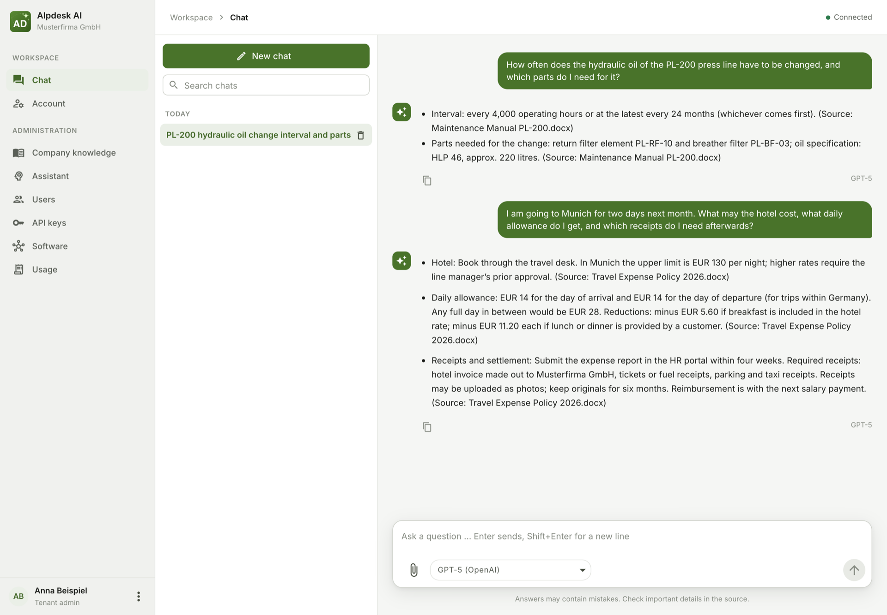
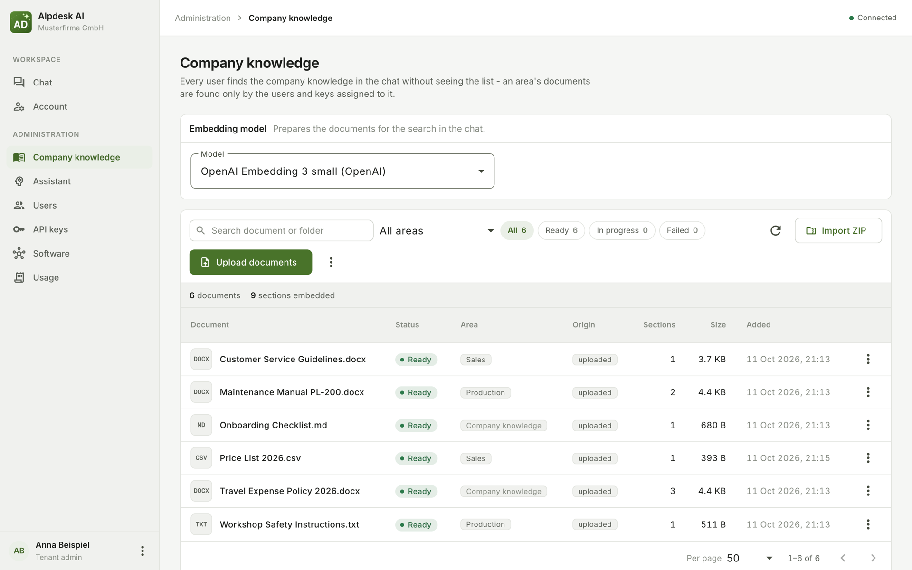
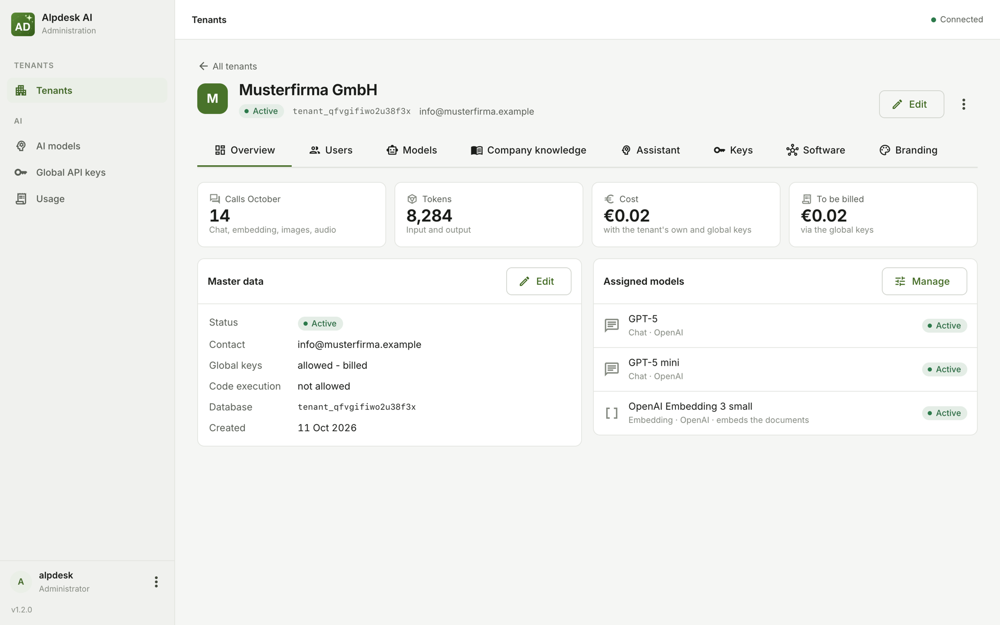

# Alpdesk AI

**An AI assistant for companies that knows their own documents - for hotels, craftsmen and industry alike. Several
companies on one installation, each with a database of its own, with the AI provider of your choice or models on your
own servers.**

[](LICENSE)
[](https://ai.alpdesk.de/)

This repository holds everything needed to run Alpdesk AI on a server of your own: the compose files, the Caddyfile,
the template of the settings and this guide. The images come from the GitHub Container Registry:

| Image | What it is |
|---|---|
| `ghcr.io/xprojects-de/alpdesk-ai:<version>` | The application: a Micronaut (Java 25) backend with the web frontend baked in |
| `ghcr.io/xprojects-de/alpdesk-ai-sandbox:<version>` | Optional: the sandbox in which the chat runs Python and shell commands, one per tenant |
| `ghcr.io/xprojects-de/alpdesk-ai-embeddings:latest` | Optional: Ollama with the embedding model `bge-m3` baked in, for the company's knowledge without a cloud provider (about 4 GB) |

Every release is a tag `v<version>` here, its compose files pinned to the images of that version; `main` is always
the latest release.

## What it does

- **Tenants with their own people.** Every company (tenant) gets its own database for its documents, embeddings and
  chat history. Its employees log in and chat; its tenant admins keep users, keys, the company's knowledge, the
  assistant's instructions and an eye on the usage. The operator (admin) manages the tenants, the model catalog and
  prices.
- **The company's knowledge in the chat.** Documents - one by one, as a ZIP archive with folders, or pushed by the
  company's software - are read (PDF, DOCX, ODT, RTF, TXT, Markdown, HTML, PPTX, XLSX, ODS, CSV; images and scanned
  pages through an image model), embedded and found by every user in the chat without seeing the list.
- **A chat that works with files.** Files in the conversation (text, images, scans, audio, video), files created as
  answers (DOCX, XLSX, PDF, CSV, ...), chat templates, and an agent loop with tools.
- **Any provider, or your own models.** Anthropic, OpenAI, Gemini - with the tenant's own keys or the operator's
  (then billed) - or models on own hardware through Ollama or any OpenAI-compatible server (vLLM, LM Studio, Mistral).
- **Connected to the company's software.** The client software uses the API at `/api/v1` with the tenant's API key
  (documented at `/swagger` of an installation). The chat can call the tools of the company's software over MCP -
  reading ones directly, changing ones only after the user's decision - and Claude Code or Copilot can ask the
  assistant through the tenant's own MCP server.
- **Single sign-on** through a WAM proxy that passes the signed-in person on in a header (optional).
- **Branding** per installation and per tenant: name, colour and logo.

## Screenshots

**The chat** - every user asks, the assistant answers from the company's documents and names its source:



**The company's knowledge** - what the tenant admin uploaded, its state and the knowledge area it belongs to:



**A tenant at the operator** - usage this month, master data and the models it may use:



<sub>Invented example data, answers by GPT-5.</sub>

## Security and privacy

Alpdesk AI handles company documents and employees' chats and sends them to the AI providers you configure. Before
running an installation for others, read:

- [SECURITY.md](SECURITY.md) - what the software assumes (HTTPS only, the database never reachable from outside, your
  own secrets), what it deliberately does not do, and how to report a vulnerability;
- [docs/privacy.md](docs/privacy.md) - what is stored where, what leaves the server, who is responsible under the GDPR,
  and deleting.

## Installation

Needs a Linux server (`linux/amd64`) with Podman and `podman-compose` (Docker with `docker compose` works the same),
a domain pointing at it and the ports 80 and 443 free: Caddy fetches the certificate itself and serves HTTPS only.

In the installation folder (e.g. `/opt`):

```shell
git clone https://github.com/xprojects-de/alpdesk-ai.git
cd alpdesk-ai
cp .env.example .env && chmod 600 .env                    # then replace every CHANGE_ME in .env
podman-compose -f docker-compose.prod.yml up -d
```

Open `https://<APP_DOMAIN>` and log in with `APP_USERNAME` / `APP_PASSWORD`. Then add a model to the catalog
("KI-Modelle") with a provider key, create a tenant and its first user, and chat.

Without git: download the files of a release tag ("Code" → "Download ZIP" on the tag's page) into the folder.

A required value missing in `.env` stops `podman-compose` with its name. The app refuses to start while
`APP_USERNAME`, `APP_PASSWORD`, `APP_SECRET_KEY` or `JWT_GENERATOR_SIGNATURE_SECRET` is missing, empty or still
`CHANGE_ME`, and while `DB_PASSWORD` is still `CHANGE_ME`. `DB_PASSWORD` only counts when `./pgdata` is created: an
installation whose database was initialised with another password needs the role's password changed first
(`podman exec -it alpdesk-ai-db psql -U alpdeskai -d alpdesk_ai -c "ALTER ROLE alpdeskai PASSWORD '<new>'"`), then the
value in `.env`. The Caddyfile serves HTTPS only (Caddy redirects plain HTTP) - never add a plain-HTTP site in front of
the app, since passwords and API keys would travel unencrypted. PostgreSQL never gets a published port.

Nothing of the installation is in the files of this repository: secrets and domain live in `.env`, the tenants'
sandboxes in `sandboxes/`, the database in `./pgdata` - all three ignored by git (`.gitignore`), so an update never
touches them. Don't edit the tracked files: what an installation needs differently goes into `.env`.

## Update

Take a backup first (see "Backups"), then in the installation folder:

```shell
git pull                                                   # or: git fetch --tags && git checkout v<version>
podman-compose -f docker-compose.prod.yml pull
podman-compose -f docker-compose.prod.yml up -d
for f in sandboxes/*.env; do [ -e "$f" ] || continue; n="$(basename "$f" .env)"; podman-compose --env-file "$f" -p "alpdesk-ai-sandbox-$n" -f docker-compose.tenant-sandbox.yml up -d; done
podman image prune -f                                      # removes the previous version's images
```

The embeddings image ("Embeddings with a local Ollama") has no version of its own and changes rarely; update it when
you like with `podman-compose -f docker-compose.embeddings.yml pull` and `up -d`.

A new optional setting of a release shows up in its `.env.example`; compare it with your `.env`
(`diff .env.example .env`). A new **required** one stops `podman-compose` with its name. The loop starts every
tenant's sandbox ("Code execution") with the release's image; without tenant sandboxes it does nothing. Going back to
an earlier version is the same with that version's tag - but database migrations cannot be undone, so only with the
backup taken before the update.

## Configuration

The app's environment variables, set through the file `.env` next to `docker-compose.prod.yml` (template
[.env.example](.env.example)); the compose file passes them on and takes the database password from `DB_PASSWORD`.

| Variable | Purpose |
|---|---|
| `APP_DOMAIN` | The domain Caddy serves and fetches the certificate for, without `https://` |
| `APP_USERNAME` / `APP_PASSWORD` | The admin login - the password at least 12 characters |
| `APP_SECRET_KEY` | AES key encrypting the stored AI provider keys - `openssl rand -base64 32`. **Back it up**: losing or changing it makes every stored key unreadable (they must be entered again) |
| `JWT_GENERATOR_SIGNATURE_SECRET` | JWT signing secret (at least 32 characters) - `openssl rand -base64 48`; changing it logs everyone out - change it together with a leaked `APP_PASSWORD`, whose admin sessions a new password alone does not end |
| `DB_PASSWORD` | The database password - `openssl rand -base64 48` |
| `APP_BRANDING_NAME` / `APP_BRANDING_PRIMARY_COLOR` / `APP_BRANDING_LOGO` | Optional, the installation's look (default "Alpdesk AI", `#49732a`, the Alpdesk AI logo; `APP_BRANDING_LOGO=` empty = no logo) - the login page, the admin's dashboard and every tenant the admin gave no look of its own. The logo is a PNG, JPEG or WebP of at most 512 KB: copy it into the volume `files` (`podman cp logo.png alpdesk-ai:/home/app/files/branding-logo.png`) and set `/home/app/files/branding-logo.png` |
| `APP_AI_PLAIN_HTTP_HOSTS` | Optional: the hosts of own model servers reached over plain HTTP, comma separated (e.g. `ollama,10.0.0.5`) - every other server needs HTTPS. See "Own model servers". A listed host is also exempt from the "no internal address" rule, and the exemption counts for the addresses of connected software (MCP) that every tenant admin may enter: any port of it becomes reachable to the app's requests - never list `localhost` or the app's own container |
| `USE_SYSTEM_CA_CERTS` | Optional: `1` trusts the certificates of the company's own authorities in the volume's `certificates/` - see "Own model servers" |
| `JAVA_TOOL_OPTIONS` | Optional JVM options |
| `MICRONAUT_SERVER_CONTEXT_PATH` | Optional: the sub-path behind a reverse proxy - see "Behind a reverse proxy under a sub-path" |
| `APP_WAM_ENABLED` / `APP_WAM_USER_HEADER` / `APP_WAM_NAME_HEADER` | Optional: sign-in through a WAM proxy - see "Sign-in through a WAM proxy" |

Data lives in PostgreSQL with pgvector (`./pgdata`; the schema is migrated on startup): the management database and
every tenant's own database. The chat's files (uploaded and created) live in the named volume `alpdesk-ai_files`
(mounted at `/home/app/files`; a named volume, not a bind mount, so the non-root app user can write to it). **Back up
both** - the databases only hold the files' keys.

`/watchdog` is an anonymous, side-effect-free liveness endpoint (HTTP 200) for monitoring.

## Backups

```shell
podman exec alpdesk-ai-db pg_dumpall -U alpdeskai > backup_all_$(date +%F).sql
podman run --rm -v alpdesk-ai_files:/files -v $PWD:/backup docker.io/library/alpine tar czf /backup/files_$(date +%F).tgz -C /files .
```

The first line dumps every database at once: the management database `alpdesk_ai` and every tenant's own database
(`tenant_...`, the name is shown in the admin's tenant dialog). A single one is dumped and restored this way:

```shell
podman exec alpdesk-ai-db pg_dump -U alpdeskai -Fc alpdesk_ai > backup_$(date +%F).dump
# restore into an empty database:
podman exec -i alpdesk-ai-db pg_restore -U alpdeskai -d alpdesk_ai --clean --if-exists < backup.dump
```

Keep `.env` safe as well - without `APP_SECRET_KEY` the stored provider keys cannot be read. Take a backup before every
update: database migrations cannot be undone.

## Logs

```shell
podman-compose -f docker-compose.prod.yml logs -f
```

The log lines carry date and time (`2026-10-01 14:03:12.345 [thread] LEVEL logger - message`), without colour codes.
They never contain a document's content, a prompt or a provider's answer.

## Own model servers

The admin enters an own model server with its model in the catalog (page "KI-Modelle"): provider "Ollama" (its own
API, e.g. `https://ollama.example.com`) or "OpenAI-kompatibel" (any server with the OpenAI API, e.g. a company's model
farm or `https://api.mistral.ai/v1`), the server's address and, if it asks for one, its key.

- **HTTPS only.** The server's key and the company's documents go there. Plain HTTP only to the hosts in
  `APP_AI_PLAIN_HTTP_HOSTS` - a server in the same pod or the internal network.
- **Ollama itself has neither TLS nor keys.** Put a reverse proxy in front of it that does both, e.g. a Caddy on the
  Ollama machine (the key goes into the catalog entry; the app sends it as `Authorization: Bearer <key>`):
  ```
  https://ollama.example.com {
      @authorized header Authorization "Bearer {$OLLAMA_PROXY_KEY}"
      handle @authorized {
          reverse_proxy 127.0.0.1:11434
      }
      respond 401
  }
  ```
  The context length is sent with every request (catalog field "Kontextlänge", default 32768) - the Ollama server needs
  no `OLLAMA_CONTEXT_LENGTH`, only enough memory for it.
- **The company's knowledge needs an embedding model** - a local one: "Embeddings with a local Ollama".
- **A certificate of the company's own authority** (no public one): the app must trust it - there is no setting that
  skips the certificate check. Ask the company's IT for the certificate of its root authority (PEM, the text starting
  with `-----BEGIN CERTIFICATE-----`; one file may hold several), name it `*.crt` and copy it into the volume `files`:
  ```shell
  podman exec alpdesk-ai mkdir -p /home/app/files/certificates
  podman cp company-ca.crt alpdesk-ai:/home/app/files/certificates/company-ca.crt
  ```
  Or mount a folder of the server holding them, e.g. `./company-certificates` (any name), with a compose file of your
  own next to `docker-compose.prod.yml` - a release replaces `docker-compose.prod.yml`, so the mount does not go into
  it. Mount it on `/home/app/files/certificates` (not on `/certificates`: that is a link into the volume, and the
  mount fails on it):
  ```yaml
  # docker-compose.certificates.yml
  services:
    alpdesk-ai:
      volumes:
        - ./company-certificates:/home/app/files/certificates:ro
  ```
  and start with both files, now and after every update:
  `podman-compose -f docker-compose.prod.yml -f docker-compose.certificates.yml up -d`.

  `.env`: `USE_SYSTEM_CA_CERTS=1`, then `podman-compose -f docker-compose.prod.yml up -d` (with the mount: both files,
  as above). At every start the app adds
  every `certificates/*.crt` to the public authorities it trusts (the log shows "Adding certificate with alias ...");
  it applies to own model servers, the AI providers behind a company proxy that inspects TLS, and connected software
  (MCP). Take the authority's certificate, not the server's own: that one stops working when the server gets a new
  certificate.

## Embeddings with a local Ollama

The company's knowledge needs an embedding model. Where the documents must not go to a cloud provider and the model
server offers none (an OpenAI-compatible model farm often serves chat models only), the image
`ghcr.io/xprojects-de/alpdesk-ai-embeddings` does it: Ollama with `bge-m3` (multilingual, 1024 dimensions) baked in,
about 4 GB. Once pulled it needs no internet - also no download of the model at its start.

```shell
podman-compose -f docker-compose.embeddings.yml up -d          # after docker-compose.prod.yml, whose network it joins
```

- **`.env`**: `APP_AI_PLAIN_HTTP_HOSTS=alpdesk-ai-embeddings`, then `podman-compose -f docker-compose.prod.yml up -d` -
  plain HTTP is fine here: the container has no published port and is reached inside the stack's network only.
- **The catalog entry** (page "KI-Modelle"): provider "Ollama", kind "Embedding", address
  `http://alpdesk-ai-embeddings:11434`, model name `bge-m3`, dimension `1024`, no key.
- Then the tenant (or the admin) chooses it as the tenant's embedding model; changing it later embeds every document
  again.
- **A server without internet** gets the image as a file: `podman pull ghcr.io/xprojects-de/alpdesk-ai-embeddings:latest`
  and `podman save -o embeddings.tar ghcr.io/xprojects-de/alpdesk-ai-embeddings:latest` where the internet is
  reachable, copy it, `podman load -i embeddings.tar` - the same for the app's images.
- It needs memory for the model (well over 1 GB) and runs as any user but root (10001 in the image) on a read-only
  root; `/tmp` must be writable (Ollama writes a key of its own there at every start).

## Behind a reverse proxy under a sub-path

Alpdesk AI can run under a sub-path of another web server, e.g. `https://intranet.example.com/alpdesk-ai/` behind an
nginx that serves other applications too. One setting does it, in `.env`:

```shell
MICRONAUT_SERVER_CONTEXT_PATH=/alpdesk-ai
```

The app then serves everything below that path - API, login, `/mcp`, `/watchdog`, Swagger and the frontend; the MCP
key's Claude Code command and the Copilot configuration show the full address
(`https://intranet.example.com/alpdesk-ai/mcp`). Without the setting (or empty) everything stays at `/`. The same image
runs either way.

nginx passes the path through unchanged - no rewriting:

```nginx
location /alpdesk-ai/ {
    # No trailing slash and no URI after the address: the path reaches the app as it is (/alpdesk-ai/...).
    proxy_pass http://127.0.0.1:19100;

    proxy_set_header Host              $host;
    proxy_set_header X-Real-IP         $remote_addr;
    proxy_set_header X-Forwarded-For   $proxy_add_x_forwarded_for;
    proxy_set_header X-Forwarded-Proto $scheme;

    # The chat streams its answer (server-sent events): nginx must not hold it back until the end ...
    proxy_buffering off;
    proxy_cache off;
    proxy_http_version 1.1;
    proxy_set_header Connection "";
    # ... nor close it while a model thinks before its first word (nginx's default is 60s).
    proxy_read_timeout 600s;
    proxy_send_timeout 600s;

    # ZIP archives of documents up to 512 MB.
    client_max_body_size 512m;
}
```

- `proxy_pass` points at where the app's port is published on the nginx machine: behind nginx the stack's Caddy is not
  needed - publish the app's port on `127.0.0.1` instead (`ports: ["127.0.0.1:19100:19100"]`), or run nginx in the
  stack's network and use `http://alpdesk-ai:19100`.
- nginx terminates HTTPS. Plain HTTP between nginx and the app only on the same machine or a trusted network.
- The `location` and `MICRONAUT_SERVER_CONTEXT_PATH` must name the same path.

## Sign-in through a WAM proxy

Behind a WAM proxy (web access management - it authenticates the person and passes their user name on in a header),
tenant users sign in without a password:

```shell
APP_WAM_ENABLED=true                 # off unless set
APP_WAM_USER_HEADER=X-Remote-User    # the header with the user name (default)
APP_WAM_NAME_HEADER=X-Remote-Name    # optional: the person's name for a new user
```

- A Windows domain account in the header (`DOMAIN\name`) becomes the username `name@domain` - unique even with several
  domains. A user name in the UPN form (`name@company.com`) stays as it is.
- Someone unknown sees "Zugang angefragt". The admin finds them under **Zugangsanfragen**, assigns them to a tenant -
  approved at once (e.g. a tenant's first user, made its tenant admin) or left for the tenant admin, who approves them
  under **Benutzer** ("Wartet auf Freigabe") - or rejects them.
- Tenant users and tenant admins have no password and sign in through the proxy only; the password login stays for
  the admin (`APP_USERNAME` / `APP_PASSWORD`, "Als Administrator anmelden" on the login page). Users who had a password
  sign in through the proxy when its user name equals their username.
- Every request is checked against the header: when another person signs in at the proxy on the same computer, the
  first one's session ends and the second one is signed in.
- **The app trusts the header completely**: the proxy must remove `APP_WAM_USER_HEADER` (and `APP_WAM_NAME_HEADER`)
  from every request coming from outside, and the app must be reachable through the proxy only - never publish its
  port anywhere else. Whoever reaches it past the proxy can sign in as anyone.

## Code execution

The chat's model may run Python and shell commands on the question's files. They run in a container of its own, the
**sandbox** (`ghcr.io/xprojects-de/alpdesk-ai-sandbox`). It needs no root, no capabilities and no cgroups and runs on
any kernel from 4.x on.

**Every tenant that wants code execution gets a sandbox of its own** - the container keeps tenants apart; within it one
instance runs one answer's code at a time and deletes everything of it after. The admin enters the tenant's instances
and their token at the tenant (page "Mandanten", dialog of the tenant) and checks them on the tenant's page ("Sandbox
prüfen"); without them the tools are simply not offered. Nothing of it is in `.env`.

An idle instance takes about 20 MB of memory and next to no CPU; while code runs it may take up to the container's
limit (2 GB). Size the server by the answers running code at the same time, not by the number of tenants: 100 idle
tenants are about 2 GB.

**Compose** - `docker-compose.tenant-sandbox.yml`, once per instance, after `docker-compose.prod.yml` is up (it joins
that file's network `sandbox`: `internal: true`, no way out, the database not in it). Each instance has a file of its
own in `sandboxes/` next to `.env` (an update never touches it), readable by root only:

```shell
mkdir -p sandboxes
(umask 077; printf 'SANDBOX_NAME=musterfirma\nSANDBOX_TOKEN=%s\n' "$(openssl rand -hex 32)" > sandboxes/musterfirma.env)
podman-compose --env-file sandboxes/musterfirma.env -p alpdesk-ai-sandbox-musterfirma -f docker-compose.tenant-sandbox.yml up -d
grep SANDBOX_TOKEN sandboxes/musterfirma.env     # the token for the tenant's dialog
```

Then, at the tenant: "Sandbox-Adressen" `http://alpdesk-ai-sandbox-musterfirma:8080`, "Sandbox-Token" the token.
`SANDBOX_NAME` is free (lower-case letters, digits and `-`) and names the container (`alpdesk-ai-sandbox-<name>`).

- **More answers of one tenant with code at the same time**: a second instance - another file (`musterfirma-2.env`,
  the same token, `SANDBOX_NAME=musterfirma-2`) and project (`-p alpdesk-ai-sandbox-musterfirma-2`), both addresses at
  the tenant, comma separated.
- **After an update** (it brings a new `docker-compose.tenant-sandbox.yml` with the new image tag): every instance is
  started again with it - the loop in "Update".
- **A tenant gives it up**: empty its addresses at the tenant, then
  `podman-compose --env-file sandboxes/musterfirma.env -p alpdesk-ai-sandbox-musterfirma -f docker-compose.tenant-sandbox.yml down`
  and delete the file. Deleting a tenant removes its addresses and token from the database - the container stays until
  it is taken down this way (it holds nothing of the tenant between answers).

**Without compose** the same by hand - the sandbox only in the internal network, which the app is in as well:

```shell
podman network create --internal alpdesk-ai-sandbox     # once; then: podman network connect alpdesk-ai-sandbox alpdesk-ai
podman run -d --name alpdesk-ai-sandbox-musterfirma --network alpdesk-ai-sandbox --read-only \
  --tmpfs /work:rw,size=1g,mode=1777 --tmpfs /tmp:rw,size=512m,mode=1777 \
  --cap-drop ALL --security-opt no-new-privileges --memory 2g --cpus 2 --pids-limit 512 --restart always \
  -e SANDBOX_TOKEN="$(openssl rand -hex 32)" ghcr.io/xprojects-de/alpdesk-ai-sandbox:<version>
```

**Kubernetes** - per tenant a StatefulSet (every pod reachable by name, one session each), a headless Service and a
Secret with its token; one NetworkPolicy for all sandboxes: only the app's pods may reach them, they reach nothing. It
fits the "restricted" pod security. The requests are what an idle instance needs - 100 tenants must not reserve 50 GB:

```yaml
apiVersion: apps/v1
kind: StatefulSet
metadata: {name: alpdesk-ai-sandbox-musterfirma}
spec:
  serviceName: alpdesk-ai-sandbox-musterfirma
  replicas: 1                       # the tenant's instances: http://alpdesk-ai-sandbox-musterfirma-0.alpdesk-ai-sandbox-musterfirma:8080, ...-1...
  selector: {matchLabels: {app: alpdesk-ai-sandbox, tenant: musterfirma}}
  template:
    metadata: {labels: {app: alpdesk-ai-sandbox, tenant: musterfirma}}
    spec:
      automountServiceAccountToken: false
      securityContext: {runAsNonRoot: true, runAsUser: 10001, runAsGroup: 10001, seccompProfile: {type: RuntimeDefault}}
      containers:
        - name: sandbox
          image: ghcr.io/xprojects-de/alpdesk-ai-sandbox:<version>
          ports: [{containerPort: 8080}]
          env: [{name: SANDBOX_TOKEN, valueFrom: {secretKeyRef: {name: alpdesk-ai-sandbox-musterfirma, key: token}}}]
          securityContext: {allowPrivilegeEscalation: false, readOnlyRootFilesystem: true, capabilities: {drop: [ALL]}}
          resources: {limits: {memory: 2Gi, cpu: "2"}, requests: {memory: 64Mi, cpu: 50m}}
          readinessProbe: {httpGet: {path: /health, port: 8080}}
          volumeMounts: [{name: work, mountPath: /work}, {name: tmp, mountPath: /tmp}]
      volumes:
        - {name: work, emptyDir: {medium: Memory, sizeLimit: 1Gi}}
        - {name: tmp, emptyDir: {medium: Memory, sizeLimit: 512Mi}}
---
apiVersion: v1
kind: Service
metadata: {name: alpdesk-ai-sandbox-musterfirma}
spec: {clusterIP: None, selector: {app: alpdesk-ai-sandbox, tenant: musterfirma}, ports: [{port: 8080}]}
---
apiVersion: networking.k8s.io/v1
kind: NetworkPolicy
metadata: {name: alpdesk-ai-sandbox}
spec:
  podSelector: {matchLabels: {app: alpdesk-ai-sandbox}}
  policyTypes: [Ingress, Egress]
  ingress: [{from: [{podSelector: {matchLabels: {app: alpdesk-ai}}}], ports: [{port: 8080}]}]
  egress: []
```

Check an instance after installing or updating with "Sandbox prüfen" on the tenant's page: reachable, token taken.

## Kubernetes

Every image fits the "restricted" pod security - checked with Podman under its constraints (a numeric user other than
root, every capability dropped, no privilege escalation, a read-only root, the runtime's default seccomp profile), the
app and the embeddings also with an arbitrary user and group 0 as OpenShift assigns them. **Not yet run on a cluster** - the first
installation there is the proof still missing. What each pod needs:

| Image | `runAsUser` / `fsGroup` | Writable (as volumes) | Probe | Mind |
|---|---|---|---|---|
| `ghcr.io/xprojects-de/alpdesk-ai` (the app) | 999 / 999 | `/home/app/files` (a PersistentVolumeClaim, ReadWriteOnce), `/tmp` (emptyDir: ZIP imports up to 512 MB, media conversion) | HTTP `/watchdog`, port 19100 | **one replica, strategy `Recreate`**: the sandbox leases and the streamed answers live in the one process; the variables of "Configuration" (plus `DATASOURCES_DEFAULT_URL`, `_USERNAME`, `_PASSWORD` for the database), the secrets from a Secret |
| `pgvector/pgvector:pg18` | 999 / 999 | `/var/lib/postgresql` (a PersistentVolumeClaim; `PGDATA` is `18/docker` below it), `/var/run/postgresql` and `/tmp` (emptyDir) | exec `pg_isready` | the app's role creates and drops the tenants' databases (CREATEDB): a PostgreSQL operator instead of this image needs pgvector in its image and that right |
| `ghcr.io/xprojects-de/alpdesk-ai-sandbox` | 10001 / - | `/work`, `/tmp` (emptyDir, `medium: Memory`) | HTTP `/health`, port 8080 | one per tenant - "Code execution" |
| `ghcr.io/xprojects-de/alpdesk-ai-embeddings` | 10001 (any) / - | `/tmp` (emptyDir) | HTTP `/api/tags`, port 11434 | the model is in the image; memory for it (bge-m3 well over 1 GB) |

The security context every one of them takes (the users as in the table):

```yaml
spec:
  securityContext: {runAsNonRoot: true, runAsUser: 999, runAsGroup: 999, fsGroup: 999, seccompProfile: {type: RuntimeDefault}}
  containers:
    - securityContext: {allowPrivilegeEscalation: false, readOnlyRootFilesystem: true, capabilities: {drop: [ALL]}}
```

## Contributing

Questions, bugs and wishes are welcome as an [issue](https://github.com/xprojects-de/alpdesk-ai/issues) - especially
from real use: a provider or model that behaves differently, a file type that should be read, a tool your company's
software needs. Describe how your company works with it rather than only the feature you want. Please **no real data**
in issues: no company documents, chat histories, names, keys or domains of your installation.

This repository is written by every release: the files here come from the project's own repository, so a pull request
here would be overwritten by the next release. An issue reaches the maintainer just as well. Security vulnerabilities
do not belong in an issue - see [SECURITY.md](SECURITY.md).

**The source code is not public for now.** Whoever wants to look into it or contribute is welcome at any time - just
get in touch, by an issue or by e-mail to `infos@x-projects.de`.

## License

[MIT](LICENSE) - © Benjamin Hummel

The images bring libraries, Ubuntu packages (ffmpeg, Python) and the Java runtime under their own licenses; the
complete list is in [THIRD-PARTY.md](THIRD-PARTY.md), the required notices in [NOTICE](NOTICE).
